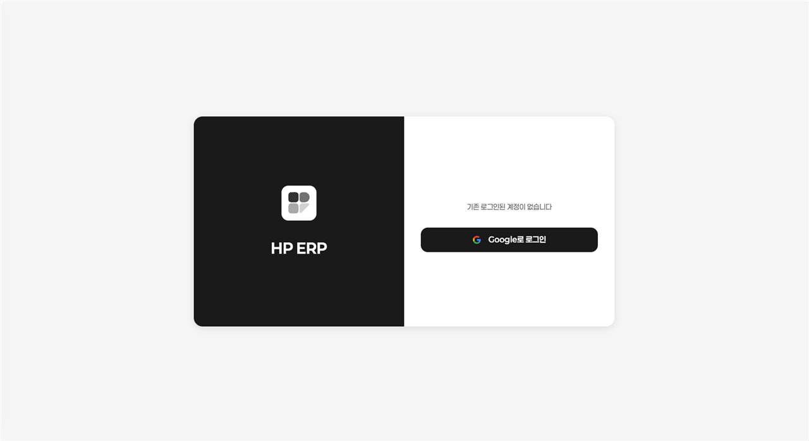
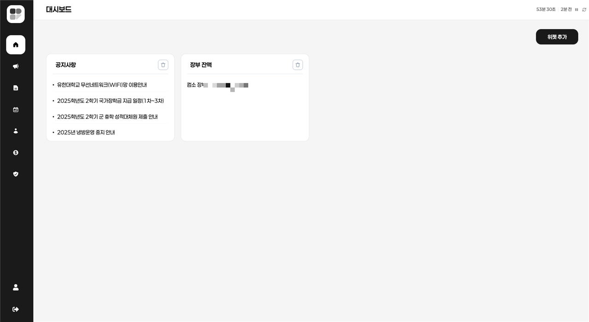
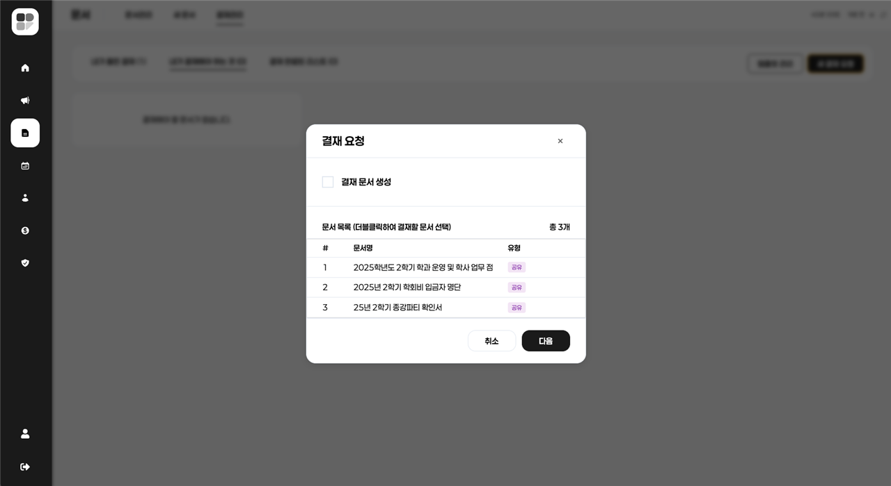
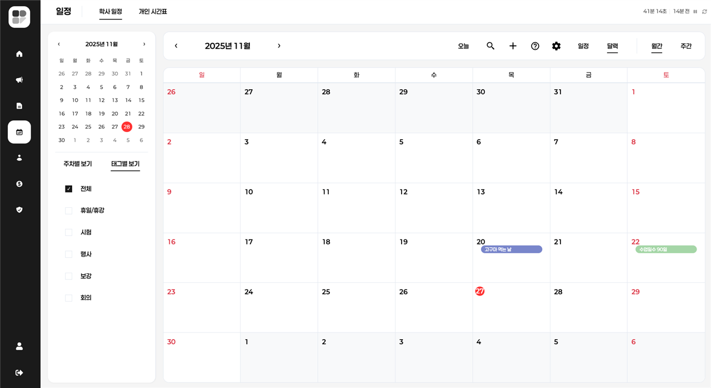
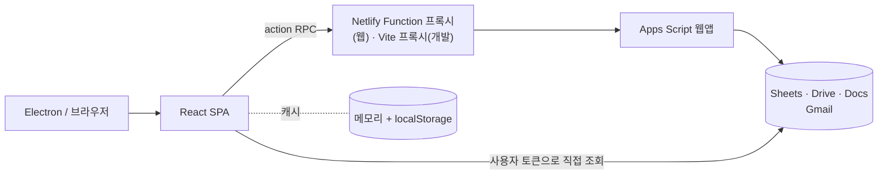

# Hot Potato ERP (뜨거운 감자)

학과 행정 업무(결재, 문서, 공지, 일정, 학생회비 장부, 학적)를 **Google Workspace 위에서 한곳에 모은 학과용 ERP**의 원본 저장소입니다.
서버와 DB 없이 Google Sheets를 데이터베이스로, Apps Script를 백엔드로 씁니다.

> **이 저장소는 2025-12-01(`ffed6c7`)에서 개발을 멈췄습니다.** 이후 정리·보강 작업과 현재 운영은 [hot_potato_remake](https://github.com/semicolon213/hot_potato_remake)에서 이어집니다.

[](https://react.dev/)
[](https://www.typescriptlang.org/)
[](https://vitejs.dev/)
[](https://www.electronjs.org/)
[](https://developers.google.com/apps-script)

## 만들게 된 이유

학과 업무에는 따로 시스템이 없었습니다. 결재는 문서를 출력해서 교수님을 찾아가 서명을 받았고, 반려되면 다시 출력했습니다. 양식은 메일과 메신저로 돌았고, 공지는 단체방에 묻혔고, 학생회비 장부와 영수증은 담당자만 알고 있었습니다.

새 서버를 들이기엔 예산도 운영할 사람도 없었습니다. 대신 학과 구성원 모두가 이미 Google 계정을 쓰고 있었습니다. 그래서 **이미 쓰고 있는 Drive·Sheets·Docs·Calendar 위에 업무 흐름만 얹자**는 방향을 잡았습니다.

문제 정의와 범위는 [docs/PROBLEM_DEFINITION.md](docs/PROBLEM_DEFINITION.md)에 정리했습니다.

## 주요 기능

- 결재: 검토선과 결재선을 나눠 단계별로 승인·반려·보류하고, 반려되면 고쳐서 다시 올립니다. 모든 처리는 이력으로 남습니다.
- 문서·양식: 공유 양식으로 문서를 바로 만들고, "나만 보기" 또는 지정한 그룹에 편집 권한을 줍니다. 공용 태그·개인 태그·즐겨찾기로 정리합니다.
- 공지사항: 역할 그룹이나 개인 단위로 공개 범위를 정하고, 관리자 승인을 받아 상단에 고정합니다.
- 회계: 장부마다 전용 폴더와 증빙 폴더를 만들고, 입출금과 영수증을 함께 기록합니다. 예산 계획은 검토 → 승인 → 집행 순서로 처리됩니다.
- 일정: 교수·학생·집행부·조교·겸임교원 캘린더를 합쳐 보고, 개인 시간표도 관리합니다.
- 학적: 학생·교직원·위원회 관리, 엑셀 일괄 등록, 유급 표시, 1월 학년 자동 갱신(Apps Script 트리거)
- 가입 관리: 학번·이름 사전 등록 + 관리자 승인제. 관리자 키는 매일 바뀝니다.
- 대시보드: 위젯을 골라 배치하고, 배치는 각자 드라이브의 개인 설정 파일에 저장됩니다.
- Google 서비스 바로가기: Apps Script, Sheets, Docs, Gemini, Groups를 앱 안에서 엽니다.

기능별 동작 여부와 알려진 결함은 [docs/STATUS.md](docs/STATUS.md)에 있습니다.

## 화면

<p align="center"></p>

<table>
  <tr>
    <td align="center"><br>대시보드 (위젯)</td>
    <td align="center"><br>공지사항</td>
  </tr>
  <tr>
    <td align="center"><br>문서 결재 요청</td>
    <td align="center"><br>일정 (월간)</td>
  </tr>
  <tr>
    <td align="center"><br>회계 · 예산 계획</td>
    <td align="center"><br>관리자 · 가입 승인</td>
  </tr>
</table>

<p align="center"><br>시스템 구성: HP ERP ↔ Apps Script ↔ Google Drive · Sheets · Docs · Groups</p>

화면은 2025년 11월 캡스톤디자인 작품보고서에 실린 캡처입니다. 개인정보(이름·이메일·학번)와 장부 잔액은 모자이크 처리했습니다.

## 팀

2025.07 ~ 2025.12 동안 6명이 666커밋으로 만들었습니다. 아래 역할은 커밋 이력에서 각자 가장 많이 작업한 영역입니다.

<table>
  <tr>
    <td align="center"><br><b>김형균</b></td>
    <td align="center"><br><b>김나윤</b></td>
    <td align="center"><br><b>문준영</b></td>
    <td align="center"><br><b>용지순</b></td>
    <td align="center"><br><b>장환희</b></td>
    <td align="center"><br><b>안창희</b></td>
  </tr>
  <tr>
    <td>Apps Script 백엔드, 회계, 결재, 관리자, 공통 유틸·타입, 배포</td>
    <td>공지사항, 문서 양식 UI, 새 문서·문서함</td>
    <td>캘린더, 양식 UI, 공통 UI 컴포넌트</td>
    <td>디자인 시스템(스타일·아이콘), 레이아웃, 화면 UI</td>
    <td>캘린더, 시간표, 대시보드</td>
    <td>대시보드 위젯</td>
  </tr>
</table>

## 기술 스택

| 구분 | 사용 기술 |
|---|---|
| Frontend | React 19, TypeScript 5, Vite 5, Tiptap, Recharts, rrule, Zustand(인증 상태) |
| Backend | Google Apps Script (V8), Netlify Functions (프록시) |
| 저장소 | Google Sheets(데이터), Google Drive(파일), papyrus-db(Sheets 접근) |
| 인증 | Google OAuth 2.0 |
| 연동 | Google Docs·Calendar·Gmail |
| 배포 | Electron 38(데스크톱), Netlify(웹) |
| 품질 | GitHub Actions CI, Jest, Testing Library, ESLint 9 |

## 구조



설계하면서 고민한 부분입니다. 전체 결정 기록은 [docs/ADR.md](docs/ADR.md)에 있습니다.

- **DB 서버 대신 Google Sheets를 썼습니다.**
  운영비가 없었고, 운영을 맡을 조교는 DB는 못 다뤄도 스프레드시트는 다룰 수 있었습니다. 대신 FK·트랜잭션이 없어서 무결성은 코드가 지켜야 하고, 열 순서가 바뀌면 코드가 깨진다는 대가가 있었습니다.
- **백엔드를 별도 서버에서 Apps Script로 옮겼습니다.**
  처음에는 관리자 키와 회원 승인을 Google Cloud에 올린 Node.js 서버가 처리했습니다. 2025-10에 이 기능을 Apps Script 웹앱으로 옮기고, 이후 공지·문서·결재·회계도 같은 웹앱에 `action`으로 더했습니다([ADR-013](docs/ADR.md#adr-013-백엔드를-cloud-run-서버에서-apps-script로-옮긴다)).
- **데이터 접근 경로를 둘로 나눴습니다.**
  회원·결재·공지처럼 Drive 조작이 필요한 일은 Apps Script를 거치고, 캘린더·학생 목록·장부처럼 자주 읽는 데이터는 브라우저가 사용자 토큰으로 Sheets를 직접 읽습니다.
- **장부마다 스프레드시트를 따로 만들었습니다.**
  장부를 만들 때 전용 폴더·시트·증빙 폴더를 새로 만들고 지정한 사람에게만 공유하면, 별도 권한 시스템 없이 Drive 권한만으로 접근을 나눌 수 있었습니다.

## 트러블슈팅

### 1. 화면마다 Apps Script를 불러 429가 자주 나던 문제

화면마다 필요한 데이터를 각자 요청하다 보니 호출이 많았고, Apps Script·Sheets API 할당량에 걸려 429(요청 과다)가 자주 났습니다. 2025-11-17~18에 요청 흐름을 바꿨습니다.

- 스프레드시트 ID는 이름 8개를 한 번에 보내 한 번에 받습니다.
- 로그인 직후 필요한 데이터를 카테고리별로 미리 받아 둡니다(카테고리는 차례로, 카테고리 안은 병렬로).
- 응답은 메모리 + localStorage 캐시에 **데이터 종류별 TTL**(결재 3분 ~ 장부 목록 45분)로 보관합니다.
- 주기 갱신은 **현재 페이지가 쓰는 데이터만** 하고, 창이 비활성이면 멈춥니다.
- 그래도 429가 오면 서버가 알려 준 대기 시간을 지키고, 그 데이터의 주기 갱신을 30~120분 멈춥니다.

남은 문제도 있습니다. 페이지 이름 표가 실제 이름과 달라 결재·문서 화면에서는 주기 갱신이 동작하지 않습니다(BUG-13). 자세한 내용은 [docs/ARCHITECTURE.md](docs/ARCHITECTURE.md#92-데이터-로딩과-캐시)에 있습니다.

### 2. 웹으로 배포하자 Apps Script 호출이 CORS에 막히던 문제

개발 중에는 Vite 개발 서버 프록시로 Apps Script를 불렀고, 데스크톱(Electron)이 주 배포 대상이었습니다. 2025-11-18 웹 배포를 시작하면서 브라우저에서 Apps Script를 직접 부르는 호출의 CORS 문제를 풀어야 했습니다.

- Netlify Function으로 프록시(`/.netlify/functions/proxy`)를 두고, 운영 빌드의 API 호출은 모두 이 프록시를 거치게 했습니다.
- Apps Script가 JSON 대신 HTML(권한·오류 페이지)을 돌려주면 프록시가 `{ success:false, error }`로 감싸서, 화면에서는 파싱 오류 대신 오류 응답으로 처리되게 했습니다.

이 구조는 리메이크에서 서버 전용 환경변수, ESM 전환, 응답 로그로 더 다듬었습니다. 증상별 대응은 [docs/RUNBOOK.md](docs/RUNBOOK.md)에 있습니다.

### 3. 1,600줄짜리 `App.tsx`로 6명이 동시에 작업하던 문제

초기에는 화면 상태와 로직이 `App.tsx` 한 파일에 1,600줄 넘게 모여 있었습니다. 6명이 기능 브랜치에서 동시에 같은 파일을 고치게 되어, 병합 충돌을 줄이는 일도 리팩터링 목표에 들어갔습니다. 2025-09-25 두 차례 리팩터링으로 구조를 나눴습니다.

- 공용 상태와 초기화는 `hooks/core/useAppState.ts`로, 화면 선택은 `components/layout/PageRenderer.tsx`로 옮겼습니다.
- 기능별로 `components/features/<도메인>`, `hooks/features/<도메인>` 폴더를 나눠, 사람마다 맡은 폴더 안에서 작업하게 했습니다.

이후 `useAppState`가 다시 커졌고 `PageRenderer`로 넘기는 props도 50개 남짓으로 늘어 과제로 남았습니다([ADR-014](docs/ADR.md#adr-014-앱-상태를-useappstate-훅으로-모은다)).

## 개발 방식

- 단계별 산출물: 문제 정의 → 요구사항 → 설계 → 구조 생성 → 구현 → 테스트 → 문서화 순서로, 단계마다 문서와 UML 다이어그램을 정리했습니다. 전체 지도는 [docs/README.md](docs/README.md)에 있습니다.
- 브랜치 전략: `main`(배포) ← `develop`(통합) ← `feature/*`. `feature/calendar`, `feature/notice`, `feature/admin` 등 기능별 브랜치로 6명이 병렬 작업했습니다([docs/CONVENTIONS.md](docs/CONVENTIONS.md)).
- CI: `main`·`develop` 푸시와 PR마다 GitHub Actions가 타입 검사·린트·테스트를 돌리고, `v*` 태그를 달면 Electron 앱을 빌드합니다.
- 운영자를 위한 문서: 실제 운영자는 학과 조교라서 [운영자 매뉴얼](docs/OPERATOR_MANUAL.md)과 [런북](docs/RUNBOOK.md)을 따로 썼습니다.

## 테스트

2026-10-27에 기준 커밋(`ffed6c7`)을 다시 검사한 결과입니다. 통과하지 못한 항목도 그대로 적었습니다.

| 검사 | 결과 |
|---|---|
| 빌드 | 통과. 메인 번들 gzip 561.5kB (번들 크기 검사는 없음) |
| 단위 테스트 (Jest) | 13개 통과, 스위트 3개 중 1개 컴파일 실패 |
| 린트 | 오류 31, 경고 416 |
| 타입 검사 (`tsconfig.app.json`) | 오류 676 (`npm run type-check`는 검사 대상 파일이 없어 항상 통과) |
| GitHub Actions (마지막 실행) | 실패 (test 잡) |

자동 테스트가 없는 핵심 흐름은 [수동 TC 27개](docs/TEST_PLAN.md#3-테스트-케이스-시트-수동-배포-환경)로 확인합니다. 결함 13건은 [docs/TEST_PLAN.md](docs/TEST_PLAN.md#6-결함-리포트-테스트코드-점검으로-발견)에 있습니다.

## 실행 방법

필요한 것: Node.js 18 이상, 배포된 Apps Script 웹앱 URL, Google OAuth 클라이언트 ID

```bash
git clone https://github.com/semicolon213/hot_potato.git
cd hot_potato
npm ci
# 루트에 .env를 만들고 VITE_GOOGLE_CLIENT_ID, VITE_APP_SCRIPT_URL 입력
npm run dev:web        # http://localhost:5173
```

| 명령 | 설명 |
|---|---|
| `npm run dev` | 웹 + Electron |
| `npm run build` | 프로덕션 빌드 |
| `npm test` / `npm run lint` | 테스트 / 린트 |
| `npm run electron:build` | 데스크톱 앱 패키징 |

- 로컬 개발: [docs/GETTING_STARTED.md](docs/GETTING_STARTED.md)
- 백엔드부터 새로 세팅하기: [docs/DEPLOYMENT.md](docs/DEPLOYMENT.md)

## 아쉬운 점

- **KPI 기준값이 없습니다.** 아날로그 방식이라 도입 전 수치가 없어, 시스템 로그로 측정할 지표만 정해 두었습니다.
- **품질 게이트가 실제로는 막지 못했습니다.** CI는 있었지만 타입 검사가 아무 파일도 검사하지 않았고 린트는 실패해도 넘어가게 되어 있어, 오류가 쌓였습니다.
- **서버 측 권한 검사가 약합니다.** 화면 단위 제어와 Drive 공유 권한에 많이 기댑니다([docs/SECURITY.md](docs/SECURITY.md)).
- **같은 일을 하는 코드가 여러 벌입니다.** Apps Script 전역 함수 이름 중복, 결재 액션 분기 중복, 쓰지 않는 화면(게시판·채팅·회의록)이 남아 있습니다.

이 중 상당수는 [리메이크](https://github.com/semicolon213/hot_potato_remake)에서 다루고 있습니다. 처리 여부는 [docs/STATUS.md](docs/STATUS.md#4-기술-백로그-기준-시점)에 적었습니다.

## 문서

| 문서 | 내용 |
|---|---|
| [문서 안내](docs/README.md) | 개발 단계별 산출물 지도 |
| [문제 정의](docs/PROBLEM_DEFINITION.md) · [요구사항(SRS)](docs/SRS.md) · [용어](docs/GLOSSARY.md) | 왜, 무엇을 |
| [아키텍처](docs/ARCHITECTURE.md) · [설계 결정(ADR)](docs/ADR.md) · [데이터 모델](docs/DATA_MODEL.md) · [API](docs/API_SPEC.md) | 어떻게 |
| [개발 시작](docs/GETTING_STARTED.md) · [코딩 규칙](docs/CONVENTIONS.md) · [배포](docs/DEPLOYMENT.md) | 개발자용 |
| [테스트](docs/TEST_PLAN.md) · [구현 상태](docs/STATUS.md) | 품질과 현황 |
| [운영자 매뉴얼](docs/OPERATOR_MANUAL.md) · [런북](docs/RUNBOOK.md) · [보안](docs/SECURITY.md) | 운영자용 |

## 라이선스

저작권은 팀 감자도리에 있으며, 사전 허가 없이 사용·복제·수정·배포·설치·운영할 수 없습니다(열람은 가능). 자세한 내용은 [LICENSE](LICENSE)를 보고, 사용 허가는 khk213624@gmail.com으로 문의해 주세요.
