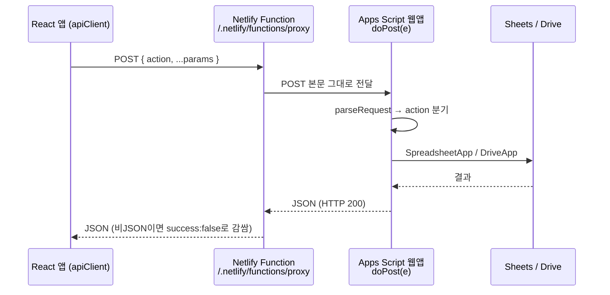

# Hot Potato ERP API 명세

> 개발 단계: **③ 설계 / ⑤ 구현** · 산출물: API 명세서
> 기준: `appScript/Main.gs`의 `doPost` 디스패치 (`main` `ffed6c7`, 2025-12-01)

## 1. 호출 구조

백엔드는 Google Apps Script 웹앱 **하나**이고, 모든 기능은 `action` 필드로 구분합니다(RPC 방식).



| 환경 | 호출 주소 | 전달 방식 |
|---|---|---|
| 로컬 개발 | `/api` | Vite dev 서버 프록시(`vite.config.ts`) → `VITE_APP_SCRIPT_URL` |
| 배포 | `/.netlify/functions/proxy` | Netlify Function(`netlify/functions/proxy.js`) → 환경변수 `VITE_APP_SCRIPT_URL` 또는 `APP_SCRIPT_URL` |

프록시를 두는 이유는 Apps Script 웹앱이 CORS 헤더를 직접 제어하지 못하기 때문입니다. [ADR-004](./ADR.md#adr-004-apps-script-앞에-netlify-function-프록시를-둔다) 참고.

### 1.1 클라이언트 (`src/utils/api/apiClient.ts`)

- 본문: `{ action, ...data }`를 JSON으로 `POST`
- 타임아웃 60초, 최대 5회 재시도(지수 백오프 1s → 2s → 4s …), 429 응답 시 `Retry-After` 준수
- 조회 액션(`CACHEABLE_ACTIONS`, `src/utils/cache/cacheUtils.ts`)은 응답을 캐시하고, 쓰기 액션이 성공하면 관련 캐시를 무효화
- 설정값: `src/config/api.ts` (`API_CONFIG`, `API_ACTIONS`)
- 일부 코드는 `apiClient`를 거치지 않고 `fetch`로 직접 호출합니다(예: 학생·교직원 연락처 일괄 복호화, `papyrusManager.ts`).

### 1.2 응답 형식

```jsonc
// 성공
{ "success": true, "data": { /* ... */ }, "message": "선택" }
// 실패 (Apps Script)
{ "success": false, "message": "오류 설명" }
// 실패 (프록시: HTTP 500 또는 Apps Script 응답 코드)
{ "success": false, "error": "오류 설명" }
```

- Apps Script는 오류가 나도 **항상 HTTP 200**을 반환합니다. 성공 여부는 반드시 `success`로 판단합니다.
- 일부 액션은 결과를 `data`가 아닌 필드로 돌려줍니다: `getAllUsers` → `users`, `getAnnouncements` → `announcements`, `checkUserStatus` → 최상위 `isRegistered / isApproved / approvalStatus`.
- 분기에 없는 액션: `{ success:false, message:"알 수 없는 액션입니다: …", debug:{…} }`
- `GET` 요청은 헬스체크 전용입니다: `{ success:true, message:"Hot Potato App Script is running", timestamp }`

### 1.3 디스패치 구조

`doPost`는 두 단계로 분기합니다.

1. `doPost` 본문 — 암호화, 문서·양식·태그, 인증, 회계, 학생 액션 (34개)
2. `callUserManagementPost` — 관리자, 공지, 결재 액션 (34개)

고유 액션은 **68개**입니다. 분기(`if`)는 82개인데, 결재 액션 14개가 두 번 적혀 있어 두 번째 블록에는 도달하지 않습니다.

## 2. 액션 목록

권한 정책(역할별 접근, 관리자 전용 기능)은 [SECURITY.md](./SECURITY.md)에 정리했습니다.

### 2.1 회원 · 인증 · 관리자 (12)

| action | 필수 파라미터 | 설명 |
|---|---|---|
| `checkUserStatus` | `email` | 가입·승인 상태 조회 (프론트 `checkApprovalStatus()`가 이 액션을 호출) |
| `checkApprovalStatus` | `email` | 위와 같은 데이터, `{data:{status,user}}` 형식 |
| `getUserNameByEmail` | `email` | 이메일 → 이름 |
| `registerUser` | `name, email, studentId` (+`userType, role`) | 미리 등록된 학번·이름 행에 가입 정보 기록, 승인 대기(`X`). 프론트 `submitRegistrationRequest()`가 이 액션을 호출 |
| `verifyAdminKey` | `adminKey` | 관리자 키 검증 |
| `getAllUsers` | — | 전체 사용자 + 대기/승인 분리 목록 |
| `getPendingUsers` | — | 승인 대기 목록 |
| `approveUserWithGroup` | `studentId, groupRole` | 승인(`O`) 후 해당 Google 그룹 관리자에게 추가 요청 메일 발송, `group_management_log`에 기록 |
| `rejectUser` | `studentId` | 가입 거부 (구 스키마 `users` 시트 사용 — 수정 필요) |
| `addUsersToSpreadsheet` | `users:[{no_member,name_member}]` | 학번·이름 사전 등록 (중복 건너뜀) |
| `clearUserCache` | — | 사용자 캐시 삭제 |
| `sendAdminKeyEmail` | `userEmail` | 관리자 키 안내 메일 발송 |

### 2.2 암호화 (4)

| action | 필수 파라미터 | 설명 |
|---|---|---|
| `encryptEmail` | `data` | 이메일·전화번호 암호화 |
| `decryptEmail` | `data` | 복호화 |
| `batchEncryptEmail` | `data[]` | 일괄 암호화 |
| `batchDecryptEmail` | `data[]` | 일괄 복호화 |

### 2.3 문서 · 양식 · 태그 (14)

| action | 필수 파라미터 | 설명 |
|---|---|---|
| `createDocument` | `title, creatorEmail` (+`templateType, editors[]`) | 빈 문서 생성 또는 양식 복사 → 권한 부여 → `문서/공유 문서`로 이동 |
| `getDocuments` | `role` (+`searchTerm, author, sortBy, page, limit`) | 공유 문서 목록, 페이지네이션 |
| `deleteDocuments` | `documentIds[], role` | 문서 삭제 (레거시 시트 경로) |
| `uploadSharedDocument` | `fileName, fileContentBase64, meta` | 파일 업로드(Office → Google 형식 변환) |
| `getTemplates` | — | `문서/양식` 양식 목록 |
| `getSharedTemplates` | — | 공유 양식 + 메타데이터 |
| `uploadSharedTemplate` | `fileName, fileContentBase64, meta` (+`fileMimeType`) | 공유 양식 업로드 (base64 약 12MB 이하) |
| `updateSharedTemplateMeta` | `fileId, meta` (+`editorEmail`) | 양식 메타 수정 |
| `deleteSharedTemplate` | `fileId` (+`userEmail`) | 양식 삭제 |
| `getStaticTags` | — | 공용 태그 목록 |
| `addStaticTag` | `tag` (+`userEmail`) | 태그 추가 |
| `updateStaticTag` | `oldTag, newTag` (+`confirm, userEmail`) | `confirm` 없으면 영향받는 양식만 반환, 있으면 실제 수정 |
| `deleteStaticTag` | `tag` (+`confirm, deleteTemplates, userEmail`) | 2단계 삭제 |
| `getSpreadsheetIds` | `spreadsheetNames[]` | 스프레드시트 이름 → ID |

### 2.4 공지사항 (9)

공통 파라미터: `spreadsheetName` (공지 스프레드시트 이름, 기본 `notice`)

| action | 필수 파라미터 | 설명 |
|---|---|---|
| `getAnnouncements` | `userId, userType` | 공개 범위로 거른 뒤 고정 공지를 먼저 정렬 |
| `createAnnouncement` | `writerEmail, title, content` (+`writerName, accessRights, fileNotice, isPinned`) | 공지 작성, 본문 이미지는 Drive 업로드 후 URL로 치환 |
| `updateAnnouncement` | `announcementId, userId` | 수정 |
| `deleteAnnouncement` | `announcementId, userId` | 삭제 |
| `incrementAnnouncementView` | `announcementId` | 조회수 +1 |
| `requestPinnedAnnouncement` | `announcementId, userId` | 고정 요청 (`fix_notice='-'`) |
| `approvePinnedAnnouncement` | `announcementId, approvalAction` | `approve` → `O`, 그 외 → `X` |
| `getPinnedAnnouncementRequests` | — | 고정 요청 대기 목록 |
| `getAnnouncementUserList` | — | 공개 범위 선택용 사용자 목록 |

### 2.5 결재(워크플로우) (18)

| action | 필수 파라미터 | 설명 |
|---|---|---|
| `requestWorkflow` | `requesterEmail, reviewLine[], paymentLine[]` + 문서 정보 | 결재 등록, 결재선 참여자에게 열람 권한 부여 |
| `grantWorkflowPermissions` | `documentId, userEmails[]` | 문서 권한 부여 |
| `getWorkflowStatus` | `workflowId` 또는 `documentId` | 단건 조회 |
| `getMyPendingWorkflows` | `userEmail` (+`lineType, status`) | 내가 처리할 결재 |
| `getMyRequestedWorkflows` | `userEmail` | 내가 올린 결재 |
| `getCompletedWorkflows` | `userEmail` (+기간) | 완료·반려된 결재 |
| `approveReview` / `rejectReview` / `holdReview` | `workflowId, userEmail` (+`opinion, rejectReason, holdReason`) | 검토 단계 처리 |
| `approvePayment` / `rejectPayment` / `holdPayment` | 위와 같음 | 결재 단계 처리 (검토 전원 승인 후) |
| `resubmitWorkflow` | `workflowId, userEmail` (+결재선·내용 수정) | 반려 건 재상신 |
| `getWorkflowHistory` | `workflowId` | 처리 이력 |
| `createWorkflowTemplate` | `creatorEmail, templateName, reviewLine, paymentLine` | 결재선 템플릿 생성 |
| `getWorkflowTemplates` | — | 템플릿 목록 |
| `updateWorkflowTemplate` | `templateId, userEmail` | 템플릿 수정 |
| `deleteWorkflowTemplate` | `templateId, userEmail` | 템플릿 삭제 |

결재 상태 전이는 [ARCHITECTURE.md의 상태 다이어그램](./ARCHITECTURE.md#6-상태-다이어그램)을 참고하세요. 상태 값은 [GLOSSARY.md](./GLOSSARY.md)에 있습니다.

### 2.6 회계 (5)

장부 **데이터**(입출금, 예산계획)는 프론트가 Sheets API로 직접 읽고 씁니다. Apps Script는 장부 구조 생성과 권한 설정만 맡습니다.

| action | 필수 파라미터 | 설명 |
|---|---|---|
| `createLedger` | `ledgerName, accountName, creatorEmail, mainManagerEmail` (+`initialBalance, accessUsers[], accessGroups[], subManagerEmails[]`) | 장부 폴더, 스프레드시트, `증빙` 폴더 생성 + 공유 |
| `getLedgerList` | — | 장부 목록 |
| `updateAccountSubManagers` | `spreadsheetId, accountId, subManagerEmails[]` | 부관리인 변경 |
| `getAccountingFolderId` | — | `회계/` 폴더 ID (없으면 생성) |
| `getAccountingCategories` | `spreadsheetId` | 카테고리 목록 |

### 2.7 학생 (3)

| action | 필수 파라미터 | 설명 |
|---|---|---|
| `getStudentRetainedStatus` | `studentId, spreadsheetId` | 유급 여부 조회 |
| `updateStudentRetained` | `studentId, spreadsheetId, isRetained` | 유급 여부 변경 (`O` 또는 빈칸) |
| `updateStudentGrades` | `spreadsheetId` | 전체 학생 진급. 3학년은 학년 `-`, 상태 `졸업`으로 처리. 휴학·졸업생 제외 |

`updateStudentGrades`는 프론트에서 호출하지 않습니다. 시간 기반 트리거 `handleAnnualGradeUpdate`(1월에만 실행)가 같은 함수를 직접 부릅니다.

### 2.8 진단용 (3)

운영 환경에서는 쓰지 않는 점검용 액션입니다. 프론트에서는 양식 관리 훅(`src/hooks/features/templates/useTemplateUI.ts`)만 호출합니다.

| action | 설명 |
|---|---|
| `testDriveApi` | Drive API 연결 확인 |
| `testSpecificFolder` | 특정 폴더 접근 확인 |
| `testTemplateFolderDebug` | 양식 폴더 탐색 디버그 |

### 2.9 Apps Script 액션이 없는 기능

| 기능 | 처리 방식 |
|---|---|
| 캘린더, 학생·교직원 목록, 학생 이슈, 장부 데이터, 개인 설정 | 프론트가 `papyrus-db` + Sheets API로 직접 처리 (`src/utils/database/*`, `src/utils/google/*`) |
| 대시보드 회계 요약, 승인 대기 예산 | `googleSheetUtils.ts`의 `getAccountingCategorySummary`, `getPendingBudgetPlans`가 시트를 직접 읽음 |
| 초기 세팅 (`initializeSystem`) | Apps Script 편집기에서 수동 실행 ([OPERATOR_MANUAL.md](./OPERATOR_MANUAL.md)) |
| 관리자 키 일일 갱신 (`handleDailyKeyUpdate`) | 시간 기반 트리거 |
| 학년 일괄 진급 (`handleAnnualGradeUpdate`) | 시간 기반 트리거 |

## 3. 프론트와 백엔드의 차이

### 3.1 프론트에만 있는 액션

아래 이름은 프론트(`src/config/api.ts`의 `API_ACTIONS` 또는 `apiClient` 메서드)에 정의되어 있지만 `doPost`에 분기가 없습니다. 호출하면 "알 수 없는 액션"을 받습니다.

| 이름 | 프론트 위치 | 실제 호출 여부 |
|---|---|---|
| `approveUser` | `API_ACTIONS.APPROVE_USER` | 호출 없음 (승인은 `approveUserWithGroup` 사용) |
| `submitRegistrationRequest` | `API_ACTIONS.SUBMIT_REGISTRATION_REQUEST` | 상수만 있음. 같은 이름의 메서드는 `registerUser`를 보냄 |
| `requestPinnedAnnouncementApproval` | `apiClient.requestPinnedAnnouncementApproval()` | 호출 없음 (실제로는 `requestPinnedAnnouncement` 사용) |
| `migrateEmails` | `apiClient.migrateEmails()` | 호출 없음 |
| `testEmailEncryption`, `testAllAppScript` | `apiClient` 메서드 | `src/utils/api/migrationTest.ts`에서만 호출하며, 이 파일은 어디서도 import되지 않음 |
| `setWorkflowLine` | `apiClient.setWorkflowLine()` | 호출 없음 |
| `getAccountingCategorySummary`, `getPendingBudgetPlans` | `apiClient` 메서드 | 호출 없음 (같은 이름의 시트 직접 조회 함수를 대신 사용) |

### 3.2 백엔드에만 있는(프론트가 부르지 않는) 액션

| action | 비고 |
|---|---|
| `checkApprovalStatus` | 프론트의 같은 이름 메서드는 `checkUserStatus`를 보냄 |
| `getWorkflowStatus`, `grantWorkflowPermissions` | `apiClient` 메서드는 있으나 호출하는 화면이 없음 |
| `getAccountingCategories` | `apiClient` 메서드는 있으나 호출하는 화면이 없음 |
| `updateStudentGrades` | 트리거 전용 |

### 3.3 정리가 필요한 부분

| 항목 | 내용 |
|---|---|
| 중복 분기 | `callUserManagementPost`에 결재 액션 14개 분기가 두 번 있고, 두 번째 블록은 도달하지 않습니다 |
| 응답 형식 | 결과 필드 이름이 액션마다 다르고, 일부 응답에는 진단용 필드가 섞여 있습니다. `{success, data, message}`로 통일하는 것이 목표입니다 |
| `CONFIG.gs`의 `SUPPORTED_ACTIONS` | 실제 디스패치와 맞지 않는 오래된 목록입니다(존재하지 않는 `approveUser`, `submitRegistrationRequest`, `test*` 등 포함) |
| 알 수 없는 액션 응답의 `allActions` | 결재·관리자 액션 24개만 나열해 실제 68개와 다릅니다 |

이 항목들은 [hot_potato_remake](https://github.com/semicolon213/hot_potato_remake)에서 일부 정리되었습니다(예: 일괄 암·복호화를 `decryptEmailBatch` 하나로 통합, 학년·취업 관리 액션 추가로 79개).
