# Hot Potato ERP 아키텍처

> 개발 단계: **④ 구조 생성**(Component·Deployment) · **③ 설계**(Sequence·Class) · **⑤ 구현**(State) · **⑥ 테스트**(Communication) · **⑦ 문서화**(Package)
> 기준: `main` @ `ffed6c7` (2025-12-01). 이 저장소는 이 시점에서 동결되었고, 이후 개발은 [hot_potato_remake](https://github.com/semicolon213/hot_potato_remake)에서 이어집니다.

설계 결정의 **이유**는 [ADR.md](./ADR.md)에, 데이터 구조는 [DATA_MODEL.md](./DATA_MODEL.md)에 있습니다. 이 문서는 시스템이 **어떻게 생겼고 어떻게 움직이는지**를 다룹니다.

## 1. 시스템 개요

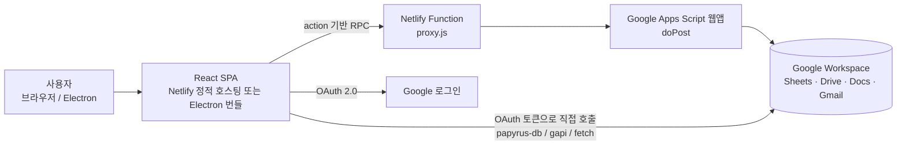

| 계층 | 기술 | 역할 |
|---|---|---|
| 클라이언트 | React 19, TypeScript 5.0, Vite 5, Tiptap, Recharts | 화면, 상태(`useAppState` 훅), 캐시 |
| 데스크톱 셸 | Electron 38 (`electron/main.cjs`, `preload.js`) | 같은 번들을 데스크톱 앱으로 실행. `npm run dev`의 기본 실행 대상 |
| 프록시 | Netlify Functions (CommonJS `exports.handler`) | 웹 배포에서 CORS 처리 (2025-11-18 도입) |
| 백엔드 | Google Apps Script | 회원·공지·결재·문서·장부 생성 처리, Drive 권한 조작 |
| 저장소 | Google Sheets, Google Drive | 데이터(시트), 파일(Drive) |
| 인증 | Google OAuth 2.0 (implicit, `response_type=token`) | 로그인, Sheets·Drive·Calendar 직접 접근 토큰 |

상태 관리 라이브러리는 거의 쓰지 않습니다. `zustand`는 `src/hooks/features/auth/useAuthStore.ts` 한 곳에서만 쓰이고, 나머지 공용 상태는 `src/hooks/core/useAppState.ts`가 `useState`로 들고 있습니다.

## 2. Component 다이어그램

모듈 경계와 의존 방향입니다. 프론트엔드에서 백엔드로 가는 길은 **apiClient(Apps Script 경유)**와 **Database Managers(Sheets 직접)** 두 가지가 기본입니다. 일부 훅·컴포넌트는 `fetch`로 프록시를 직접 부릅니다(아래 점선).

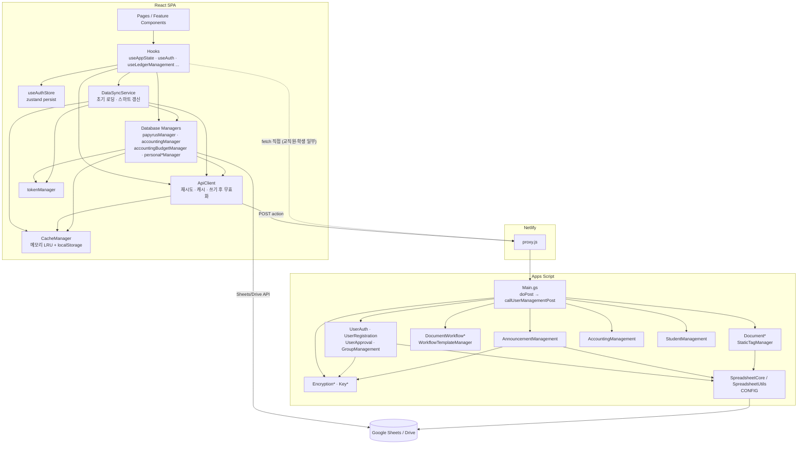

- `papyrusManager`는 공지 조회(`getAnnouncements`)와 스프레드시트 ID 조회(`getSpreadsheetIds`)를 `apiClient`로 보내고, 캘린더·학생·교직원·템플릿은 `papyrus-db`로 시트를 직접 읽습니다.
- 예산 계획(`accountingBudgetManager`)과 장부 항목(`accountingManager`)은 브라우저에서 시트를 직접 씁니다. 장부 **생성**(`createLedger`)만 Apps Script가 맡습니다.

## 3. Deployment 다이어그램

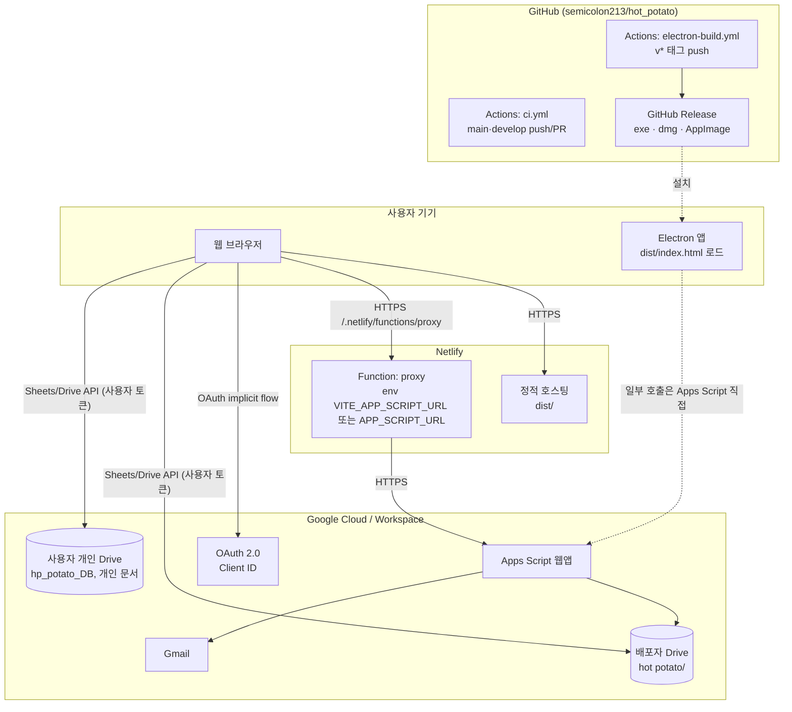

| 노드 | 배포 방식 | 설정 |
|---|---|---|
| Netlify 정적 호스팅 | Netlify가 `npm run build` 후 `dist/` 게시 (Node 18) | `netlify.toml` |
| Netlify Function | 같은 빌드에 포함 (`netlify/functions/`) | 대시보드 환경변수 `VITE_APP_SCRIPT_URL` 또는 `APP_SCRIPT_URL` |
| Apps Script | `.gs` 파일을 Apps Script 편집기에 붙여 넣고 웹앱으로 배포 (`clasp` 설정 없음) | 스크립트 속성 (`ROOT_FOLDER_NAME`, `SHEET_NAME_USER` …) |
| Electron | 로컬 `npm run electron:build`, 또는 `v*` 태그 push 시 `electron-build.yml`이 3개 OS용으로 빌드해 Release에 올림. 태그는 `v1.0.0`(2025-11-18) 하나 | `package.json`의 `build` 항목 |
| CI | `main`·`develop` push/PR 때 `ci.yml` 실행. `deploy` 잡은 메시지만 출력하고 실제 배포는 하지 않음 | `.github/workflows/ci.yml` |

- Electron에서는 `papyrusManager.getApiBaseUrl()`이 Apps Script 주소를 직접 씁니다. `apiClient`는 Electron을 따로 구분하지 않고 개발이면 `/api`, 아니면 `/.netlify/functions/proxy`를 씁니다.

절차는 [DEPLOYMENT.md](./DEPLOYMENT.md)를 참고하세요.

## 4. Sequence 다이어그램

### 4.1 로그인 → 가입 → 승인 → 첫 진입

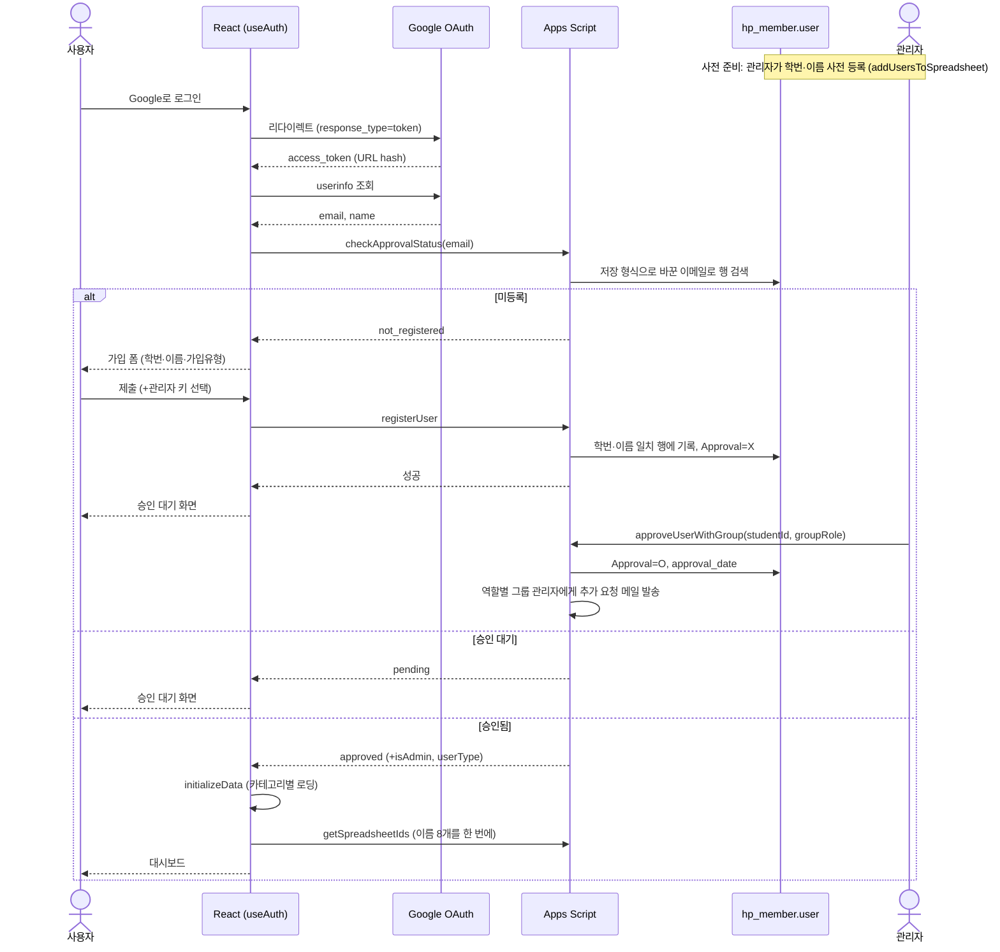

- 승인 시 Google 그룹에 **직접 추가하지 않습니다.** `GroupManagement.gs`가 그룹 관리자에게 추가 요청 메일을 보내고, 실제 추가는 사람이 합니다.

### 4.2 결재 요청과 처리

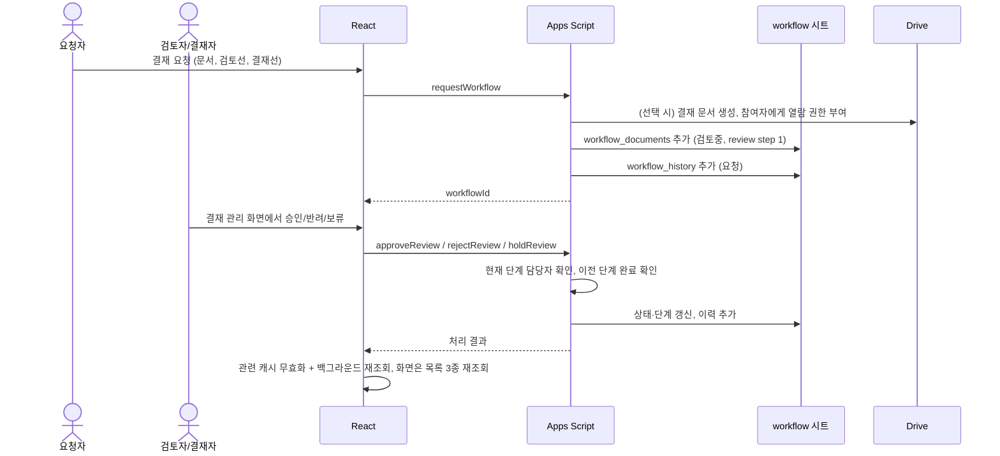

## 5. Class 다이어그램 (프론트엔드 핵심 타입)

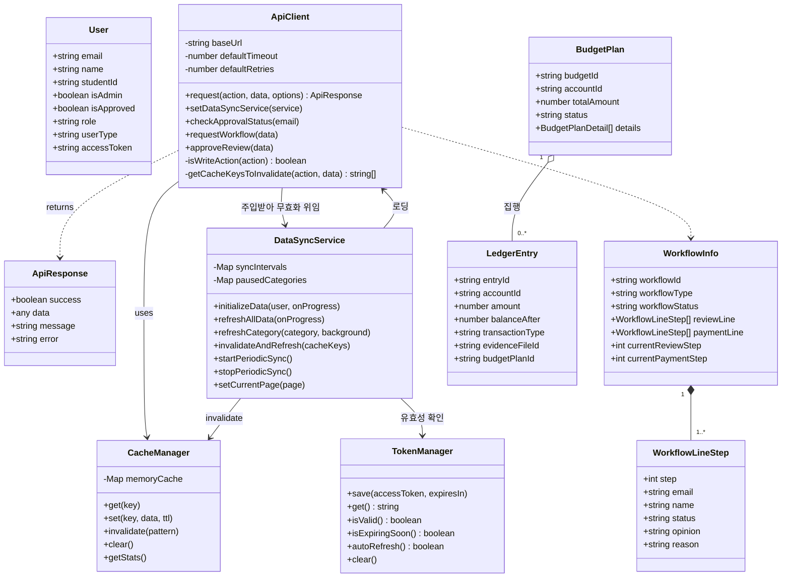

`tokenManager`는 클래스가 아니라 객체 리터럴입니다. 그림에서는 메서드 묶음을 보이려고 클래스로 그렸습니다.

## 6. 상태 다이어그램

### 6.1 회원 승인

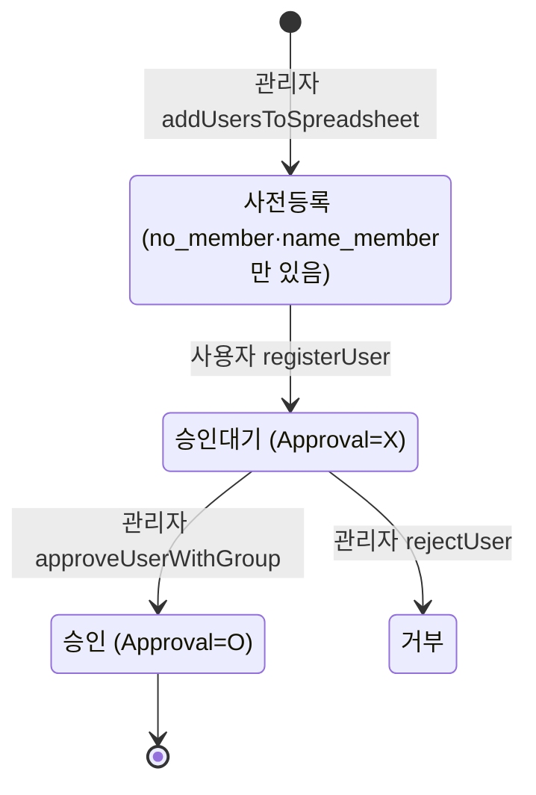

- `checkApprovalStatus`(`UserAuth.checkUserStatus`)는 이메일이 없는 사전등록 행을 `not_registered`로 돌려줍니다. 사용자 입장에서는 "가입 폼이 뜨는 상태"입니다.
- `user` 시트에는 거부를 나타내는 값이 없습니다. `rejectUser`는 존재하지 않는 `users` 시트를 찾도록 되어 있어 기준 시점 코드에서는 실패합니다(BUG-02). 운영 방법은 [OPERATOR_MANUAL.md](./OPERATOR_MANUAL.md)를 보세요.

### 6.2 결재 (`workflow_documents.workflow_status`)

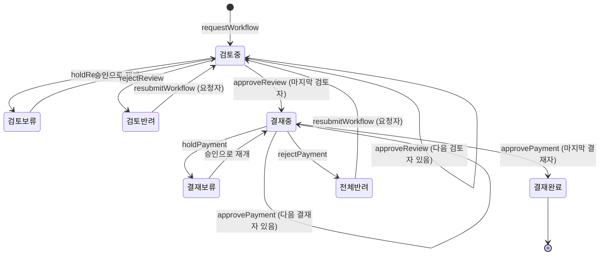

- 결재선의 각 단계는 `대기 → 승인 | 반려 | 보류`이며, 보류 단계는 승인(재개)만 할 수 있습니다.
- 검토 단계가 **모두 승인**되어야 결재 단계로 넘어갑니다.
- 모든 전이는 `workflow_history`에 한 줄씩 남습니다(`recordWorkflowHistory`).
- 프론트 타입(`src/types/documents.ts`)은 `결제중`/`결제완료`로 적혀 있어 백엔드 값과 다릅니다([DATA_MODEL.md §6](./DATA_MODEL.md#6-알려진-불일치-정리-대상)).

### 6.3 예산 계획 (`예산계획.status`)

예산 계획은 Apps Script를 거치지 않고 브라우저(`accountingBudgetManager.ts`)가 장부 스프레드시트에 직접 씁니다.

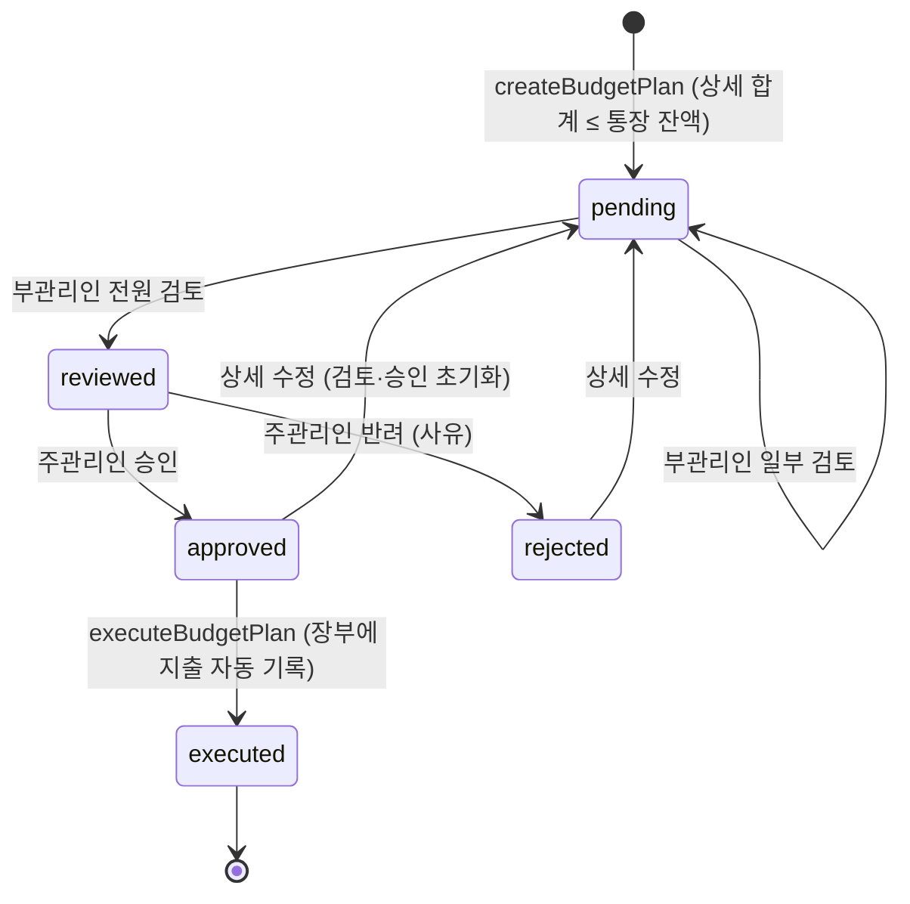

- 목록을 읽을 때(`getBudgetPlans`) 부관리인 전원이 검토했는데 `pending`인 행은 `reviewed`로 고쳐 씁니다.
- `executed` 상태는 삭제할 수 없습니다.

### 6.4 공지 고정 (`notice.fix_notice`)

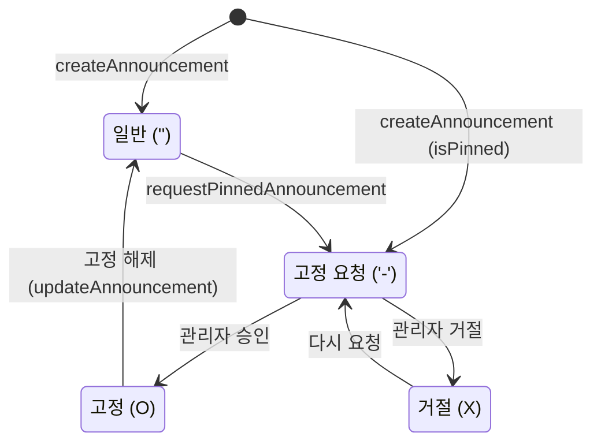

## 7. Communication 다이어그램 (결재 승인)

테스트 단계에서 객체 사이의 메시지 순서를 점검할 때 쓰는 그림입니다. 번호는 메시지 순서입니다.

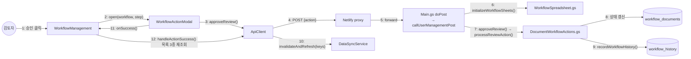

`Main.gs`의 `callUserManagementPost`에는 결재 액션 분기가 두 벌 들어 있습니다. 앞쪽 분기가 먼저 처리하므로 뒤쪽은 실행되지 않습니다.

## 8. Package 다이어그램

### 8.1 프론트엔드 (`src/`)

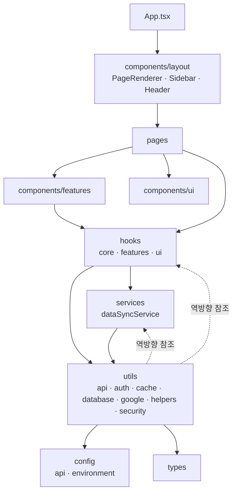

| 폴더 | 책임 |
|---|---|
| `pages/` | 화면 단위 컨테이너. 모두 정적 import (지연 로딩 없음) |
| `pages/Announcements/` | 공지 목록·상세·작성 |
| `pages/Board/` | 자유게시판(`Board`, `NewBoardPost`). 메뉴에 없고 `App`이 빈 목록을 넘김 |
| `pages/Proceedings.tsx` | 회의록. Google Docs 임베드(`GoogleDocEmbed`). 메뉴에 없음 |
| `pages/Chat.tsx` | Google Chat을 webview로 여는 패널. 어디서도 import하지 않음 |
| `components/layout/` | 앱 셸. `PageRenderer`가 `currentPage`에 따라 `switch`로 페이지를 고름 |
| `components/features/<도메인>/` | accounting, admin, auth, calendar, dashboard, documents, staff, students, templates, timetable, workflow |
| `components/ui/` | 공통 UI (`LoadingProgress`, `DataSyncStatus`, `NotificationModal`, `TiptapEditor`, `GoogleDocEmbed`, `common/` 등) |
| `hooks/core/` | `useAppState`: 사용자, 현재 페이지, 스프레드시트 ID, 공지·캘린더·위젯 등 공용 상태 |
| `hooks/features/` | 도메인 로직 (`useAuth`, `useAuthStore`, `useSession`, `useLedgerManagement`, `useWidgetManagement` …) |
| `hooks/ui/` | `useNotification` |
| `services/` | `dataSyncService`: 로그인 후 초기 로딩, 스마트 갱신, 쓰기 후 무효화 |
| `utils/api/` | `apiClient`: Apps Script 호출. `adminApi`, `authApi`, `gmailApi` |
| `utils/database/` | Sheets 직접 접근 (`papyrusManager`, `accountingManager`, `accountingBudgetManager`, `personal*Manager`) |
| `utils/cache/` | `cacheManager`, `cacheUtils`(TTL·카테고리·캐시 가능 액션 목록) |
| `utils/auth/` | `tokenManager`, `lastUserManager` |
| `config/` | API 설정(`API_CONFIG`, `API_ACTIONS`), 환경변수(`ENV_CONFIG`) |

정리할 의존성: `dataSyncService ↔ papyrusManager`, `dataSyncService ↔ accountingManager` 순환 참조가 있고, `utils → hooks/components` 역방향 참조가 3건(`papyrusManager`, `spreadsheetManager`, `widgetContentGenerator`) 있습니다([STATUS.md](./STATUS.md)).

### 8.2 Apps Script (`appScript/`)

Apps Script는 모든 파일이 **전역 스코프 하나**를 공유합니다. 아래 화살표는 "다른 파일에 정의된 전역 함수를 호출한다"는 뜻입니다.

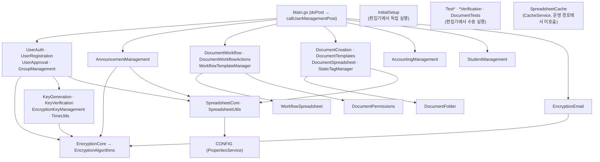

- 액션은 `Main.gs`의 if 분기로 나뉩니다. 암호화·문서·태그·회원 가입·회계·학생 액션은 `doPost` 안에서, 나머지(관리자, 공지, 결재)는 `callUserManagementPost`에서 처리합니다. 고유 액션 이름은 68개입니다([API_SPEC.md](./API_SPEC.md)).
- 같은 이름의 전역 함수가 두 파일에 있는 경우가 9건 있습니다([CONVENTIONS.md §4](./CONVENTIONS.md#4-apps-script)).

## 9. 프론트엔드 동작 방식

### 9.1 화면 전환

- 라우터 라이브러리 없이 `currentPage` 상태와 `?page=` 쿼리로 화면을 바꿉니다. `App.handlePageChange`가 `history.pushState`로 쿼리를 바꾸고, `useAppState`가 첫 렌더 때 쿼리에서 페이지를 복원합니다.
- 진입 순서: 로딩(저장된 사용자·토큰 복원) → 미로그인이면 `Login` → 미승인이면 `PendingApproval` → 앱 셸(`Sidebar` + `Header` + `PageRenderer`).
- 메뉴 노출은 역할에 따라 달라집니다. 회계는 `std_council`·`professor`·`supp`, 관리자 메뉴는 `isAdmin`일 때만 보입니다. 화면 단위 권한 검사는 아직 보강하지 못했습니다([SECURITY.md](./SECURITY.md)).
- `preferences`, `documents`, `users`, `settings`는 "구현 예정" 문구만 보여 줍니다.
- Electron 창을 닫으면 `preload.js`의 `app-before-quit` 이벤트로 `App`이 로그아웃합니다.

### 9.2 데이터 로딩과 캐시

Apps Script와 Sheets API는 호출 할당량이 있어 429(호출 초과)가 자주 났습니다. 그래서 2025-11-17~18에 캐시와 백그라운드 동기화를 넣었습니다(근거: 당시 문서 `DATA_CACHING_STRATEGY.md`, [ADR-005](./ADR.md#adr-005-클라이언트-캐시와-백그라운드-동기화)).

| 단계 | 내용 | 위치 |
|---|---|---|
| 1. 스프레드시트 ID 해석 | 이름 8개를 한 번에 보내 ID를 받음. 동시에 여러 곳에서 불러도 진행 중인 요청 하나를 같이 씀 | `papyrusManager.initializeSpreadsheetIds` |
| 2. 초기 로딩 | 작업을 카테고리(spreadsheetIds, users(관리자), documents, templates, tags, workflow, calendar, students, staff, attendees)로 묶어 **카테고리는 차례로, 카테고리 안은 병렬로** 가져옴. 실패한 작업은 로그만 남기고 넘어감. 진행률은 `LoadingProgress`에 표시 | `dataSyncService.initializeData` |
| 3. 화면 표시 | 각 화면이 같은 API를 다시 부르면 **캐시 적중**. `papyrusManager`의 `fetchCalendarEvents`, `fetchStudents`, `fetchStaff*` 등도 같은 캐시를 씀 | `apiClient`, `cacheManager` |
| 4. 스마트 갱신 | 카테고리별 주기 타이머. 현재 페이지가 쓰는 카테고리와 `spreadsheetIds`·`users`만 갱신. 창이 비활성이거나 토큰이 5분 안에 만료되면 건너뜀 | `dataSyncService.startPeriodicSync` |
| 5. 쓰기 후 | `apiClient`가 쓰기 액션 성공을 보면 관련 캐시 키를 골라 `invalidateAndRefresh`에 넘김. 해당 카테고리를 무효화하고 백그라운드로 다시 가져옴 | `apiClient.getCacheKeysToInvalidate`, `dataSyncService` |
| 6. 수동 새로고침 | 헤더의 새로고침은 캐시 전체를 지우고 2단계를 다시 실행 | `dataSyncService.refreshAllData` |

| 데이터 | 캐시 TTL | 주기 갱신 |
|---|---|---|
| 결재 (내 결재·요청·완료·상태·이력) | 3분 | 5분 |
| 회계 (장부 항목·통장·카테고리 집계·대기 예산) | 5분 | 10분 (`getLedgerList`만 다시 부름) |
| 공지·문서 | 10분 | 15분 |
| 학생 이슈 | 10분 | 따로 없음 (학생 카테고리 갱신 때 함께 무효화) |
| 캘린더 | 15분 | 15분 |
| 사용자·템플릿·태그·결재 템플릿·학생·교직원 | 30분 | 30분 |
| 스프레드시트 ID·장부 목록·회계 폴더·회계 카테고리 | 45분 | 60분 (스프레드시트 ID) |
| 목록에 없는 캐시 가능 액션 | 10분 (기본값) | - |

- 캐시 저장소: 메모리 `Map`(LRU 100개) + `localStorage`(`cache_` 접두사, 항목 100KB 이하, 전체 5MB).
- 요청 실패 시 `apiClient`는 최대 5회 재시도합니다(타임아웃 60초). 429는 `Retry-After` 값만큼, 없으면 지수 백오프(최대 60초)로 기다립니다.
- 백그라운드 갱신에서 429가 나면 그 카테고리를 30분부터 15분씩 늘려 최대 120분 쉬고, `sync429Error` 이벤트로 `DataSyncStatus`에 알립니다.
- 페이지와 카테고리를 잇는 표(`PAGE_CATEGORY_MAP`)의 키 `workflow`, `documents`는 실제 페이지 이름(`workflow_management`, `document_management`)과 달라, 결재·문서 화면에서는 페이지 기반 갱신이 일어나지 않습니다(BUG-13).
- Apps Script 쪽에도 `SpreadsheetCache.gs`(CacheService)가 있지만 운영 액션 경로에서는 호출하지 않습니다. 서버 캐시는 없다고 보면 됩니다.
- 이후 개선(오프라인 표시, 페이지 지연 로딩, 상태 저장소 분리 등)은 [hot_potato_remake](https://github.com/semicolon213/hot_potato_remake)에서 이어집니다.
