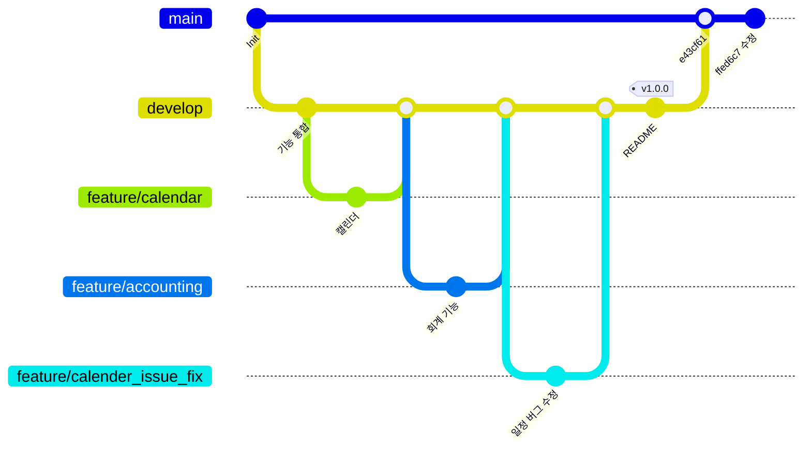

# Hot Potato ERP 코딩 규칙과 협업 가이드

> 개발 단계: **④ 구조 생성** · 산출물: 코딩 규칙, 협업 가이드(브랜치 전략)
> 기준: `main` @ `ffed6c7` (2025-12-01), 커밋 666개(2025-07-08 ~ 2025-12-01)

**규칙** 열은 이 저장소에서 지키기로 한 기준이고, **현재** 열은 기준 시점 코드가 실제로 어떤 상태인지입니다. 둘이 다른 항목은 [STATUS.md](./STATUS.md)에서 정리합니다. 이 저장소는 동결되었으므로, 정리 작업은 [hot_potato_remake](https://github.com/semicolon213/hot_potato_remake)에서 이어집니다.

## 1. 브랜치 전략

Git Flow를 단순화한 방식을 썼습니다. 기능 브랜치를 `develop`에 병합하고, `develop`을 `main`에 올렸습니다.

| 브랜치 | 용도 | 규칙 | 현재 |
|---|---|---|---|
| `main` | 배포 브랜치. CI(`ci.yml`)의 `deploy` 잡 대상 | 직접 커밋하지 않고 `develop`에서 병합 | 대부분 `develop`을 그대로 올림. 2025-11-19 `e43cf61` 병합 뒤 3개 커밋(`ad1b840`, `01c97c7`, `ffed6c7`)은 `main`에 직접 커밋 |
| `develop` | 통합 브랜치. CI 대상 | 기능 브랜치를 병합해 동작 확인 | 병합 커밋 91개 중 35개가 `into develop` |
| `feature/<기능>` | 기능 개발 | 예: `feature/calendar`, `feature/notice`, `feature/accounting`, `feature/admin`, `feature/timetable` | 기준 시점 원격에 13개 남아 있음. 이 중 `feature/grade_auto`, `feature/style`은 `main`에 없는 커밋이 2개씩 있음 |
| 버그 수정 | 별도 접두사 없음 | 기능 브랜치 이름에 `_fix`, `_issue_fix`를 붙임 (예: `feature/calender_issue_fix`) | `fix/` 브랜치는 쓰지 않음 |

- 병합은 로컬에서 `git merge`로 했고, GitHub Pull Request 병합 커밋은 없습니다.
- `feature/` 뒤 이름은 snake_case 소문자를 기본으로 합니다. 기준 시점 이력에는 `feature/Document`, `feature/Board`, `feature/calender_com`처럼 대문자·철자가 섞인 이름이 있습니다.
- 태그는 `v*` 형식이며, 태그를 push하면 `electron-build.yml`이 설치 파일을 만듭니다. 기준 시점 태그는 `v1.0.0`(2025-11-18) 하나입니다.

## 2. 커밋 메시지

| 항목 | 규칙 | 현재 |
|---|---|---|
| 언어·형식 | 한국어로 **무엇을** 바꿨는지 한 줄로 씁니다. 예: `공지사항 이미지 이슈 픽스`, `워크플로우 템플릿 추가`, `장부 내보내기 진행 중` | 병합 제외 575개 중 543개가 한국어. 초기(2025-07)에는 영어 메시지(`Calendar Component Created`)가 섞임 |
| 접두사 | Conventional Commits 접두사(`feat:` 등)는 쓰지 않습니다 | `feat:` 1건 |
| 범위 | 한 커밋에는 한 가지 목적만 담습니다 | 대형 커밋(`3차 리펙터링 및 코드 최적화` 등)이 있음 |
| 금지 | `.`, `수정`, `429`처럼 내용을 알 수 없는 메시지는 쓰지 않습니다 | `수정` 5건, `.` 1건 등 |
| 작성자 | `git config user.name`/`user.email`을 GitHub 계정으로 맞춥니다 | 작성자 `unknown` 106건, `DESKTOP-13ECS1E\pc` 28건 |

## 3. TypeScript / React

| 항목 | 규칙 | 현재 |
|---|---|---|
| 컴포넌트·페이지 파일 | PascalCase `.tsx`, 같은 이름의 `.css`를 옆에 두거나 `styles/pages/`에 둠 | 준수 |
| 훅 | `useXxx.ts` (JSX를 반환하면 `.tsx`) | 준수 |
| 유틸 | camelCase, 역할을 접미사로 (`xxxManager.ts`, `xxxUtils.ts`) | 준수 |
| 도메인 코드 위치 | `components/features/<도메인>`, `hooks/features/<도메인>` | 준수 |
| 공용 상태 | `hooks/core/useAppState.ts`에 둠. `zustand`는 인증(`useAuthStore`)에만 | 준수 |
| 의존 방향 | `pages → components → hooks → services → utils → config/types` (역방향 금지) | 위반: `utils → hooks/components` 3건, `dataSyncService ↔ papyrusManager`·`accountingManager` 순환 ([ARCHITECTURE §8.1](./ARCHITECTURE.md#81-프론트엔드-src)) |
| Apps Script 호출 | `apiClient.request(action, data)` 또는 `apiClient`의 메서드만 사용. `fetch` 직접 호출 금지 | 위반: `useStaffOnly`, `useCommitteeOnly`, `useStudentManagement`, `StudentDetailModal`, `papyrusManager`(3곳) |
| 새 Apps Script 액션 | `API_ACTIONS`에 이름 추가, 조회면 `cacheUtils`의 `CACHEABLE_ACTIONS`·`CACHE_TTL`·`ACTION_CATEGORY_MAP`, 쓰기면 `apiClient`의 `isWriteAction`·`getCacheKeysToInvalidate`에 등록 | 일부 쓰기 액션(장부 항목 등)은 시트 직접 쓰기라 목록 밖 |
| Sheets 직접 접근 | `utils/database/*` 매니저를 통해서만 | 대부분 준수 |
| 환경 의존 값 | `ENV_CONFIG`(`src/config/environment.ts`)에서 읽음. 폴더·시트 이름·URL 하드코딩 금지 | 일부 위반: `vite.config.ts`와 `papyrusManager.ts`에 Apps Script 주소 기본값, `Board.tsx`가 정의되지 않은 `ENV_CONFIG.BOARD_SHEET_NAME` 참조 |
| 타입 | `any` 금지, 새 코드는 타입을 명시 | ESLint `no-explicit-any` 경고 96건. `tsc -p tsconfig.app.json` 오류 676건 |
| 파일 머리 주석 | `@file` / `@brief` / `@details` (Doxygen 형식) | TS/TSX 187개(`.d.ts` 제외) 중 80개 |
| 로그 | 운영 코드의 `console.log`는 최소화 | `console.log` 776곳 |

### 포맷과 린트

| 도구 | 설정 | 명령 | 현재 |
|---|---|---|---|
| Prettier | `.prettierrc`(2025-10-05 추가): 작은따옴표, 세미콜론, `trailingComma: es5`, 80자, 2칸 들여쓰기, `arrowParens: avoid`, `endOfLine: lf`. `.prettierignore` | `npm run format`, `npm run format:check` | `format:check`에서 263개 파일 불일치. CI는 이 검사를 돌리지 않음 |
| ESLint 9 | `eslint.config.js`: `@eslint/js` + `typescript-eslint` + `react-hooks` + `react-refresh` 권장 규칙. `no-explicit-any`, `no-unused-vars`, `exhaustive-deps`, `only-export-components`, `ban-ts-comment`는 경고로 낮춤 | `npm run lint` | 오류 31건, 경고 416건. `.eslintignore`는 ESLint 9에서 더 이상 읽지 않아 경고가 남 |
| TypeScript | `tsconfig.app.json` (TypeScript ~5.0.4) | `npx tsc --noEmit -p tsconfig.app.json` | 오류 676건 |
| Jest | `jest.config.cjs` (ts-jest, jsdom) | `npm test`, `npm run test:ci` | 테스트 파일 4개, 그중 `Login.test.tsx`는 제외 설정 |
| 한 번에 | `npm run ci` = type-check + lint + format:check + test:ci + audit | `npm run ci` | GitHub Actions는 이 스크립트를 부르지 않고 단계를 따로 실행 ([ADR-012](./ADR.md#adr-012-github-actions로-ci와-electron-빌드를-돌린다)) |

> `npm run type-check`(`tsc --noEmit`)는 루트 `tsconfig.json`에 참조(`references`)만 있어 실제 파일을 검사하지 않고 항상 통과합니다. 타입 검사는 위의 `-p tsconfig.app.json` 명령을 쓰세요.

## 4. Apps Script

| 항목 | 규칙 | 현재 |
|---|---|---|
| 파일 이름 | 도메인 PascalCase (`UserAuth.gs`, `AccountingManagement.gs`) | 준수. 설정 파일만 `CONFIG.gs` |
| 함수 이름 | camelCase. 파일 내부 헬퍼는 `_` 접미사 | `_` 접미사는 `processAndUploadImages_` 1건 |
| 새 액션 추가 | `Main.gs`에 `if (action === '...')` 분기 추가 → 도메인 파일에 핸들러 → 프론트 `apiClient` 메서드 → [API_SPEC.md](./API_SPEC.md) 갱신 | 분기가 `doPost`와 `callUserManagementPost` 두 곳에 나뉘어 있고, 결재 분기는 두 벌 중복 |
| 응답 형식 | `{ success, data, message }` | 대부분 준수. 일부 액션은 다른 키(`users` 등)로 돌려줌 |
| 전역 이름 | Apps Script는 모든 파일이 전역 스코프를 공유합니다. **같은 이름의 함수를 두 파일에 만들지 않습니다** | 9건 중복: `verifyAdminKey`(UserAuth·KeyVerification), `analyzeKeyStrength`, `createKeyBackup`, `restoreKeyBackup`(EncryptionKeyManagement·Key*), `getSheetIdByName`(DocumentSpreadsheet·SpreadsheetUtils), `setDocumentPermissions`(DocumentPermissions·Main), `testDocumentCreation`, `testDocumentPermissions`, `testSpecificFolder` |
| 설정값 | 폴더·시트 이름은 스크립트 속성(`PropertiesService`)에서 읽고 기본값을 둠 | 준수. 일부 이름(`증빙`, 시트 `user`)은 코드에 고정 |
| 개인정보 | 이메일은 `EncryptionCore`의 변환 함수를 거쳐 저장 | 준수 ([SECURITY.md](./SECURITY.md)) |
| 테스트·검증 코드 | 운영 웹앱과 분리 | `Test*.gs`, `*Verification.gs`, `DocumentTests.gs`가 같은 프로젝트에 있음 |
| 배포 | 저장소의 `.gs`를 Apps Script 편집기에 반영한 뒤 웹앱 새 버전 배포 | `clasp` 설정 없음. 수동 복사 ([DEPLOYMENT.md](./DEPLOYMENT.md)) |

## 5. 문서

- 기능이나 API를 바꾸면 같은 커밋에서 관련 문서(`API_SPEC`, `DATA_MODEL`, `STATUS`)도 고칩니다.
- 구현 상태는 [STATUS.md](./STATUS.md) **한 곳**에서만 관리합니다. 다른 문서에는 상태를 적지 않고 링크합니다.
- 다이어그램은 Mermaid로 문서 안에 둡니다. 이미지로 따로 만들지 않습니다.
- 개발 당시 저장소 루트와 `appScript/`에 있던 문서(`PROJECT_DOCUMENTATION.md`, `DATA_CACHING_STRATEGY.md`, `CI_CD_*.md` 등)는 [archive](./archive/)에 보관했습니다. 내용이 코드와 다르면 코드와 이 `docs/` 문서가 기준입니다.
