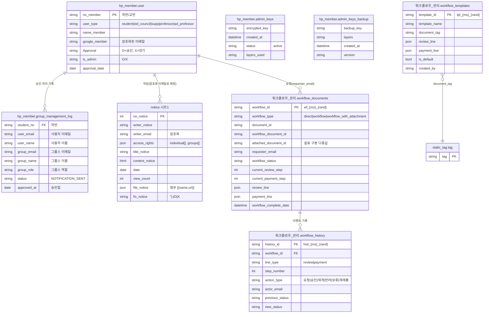
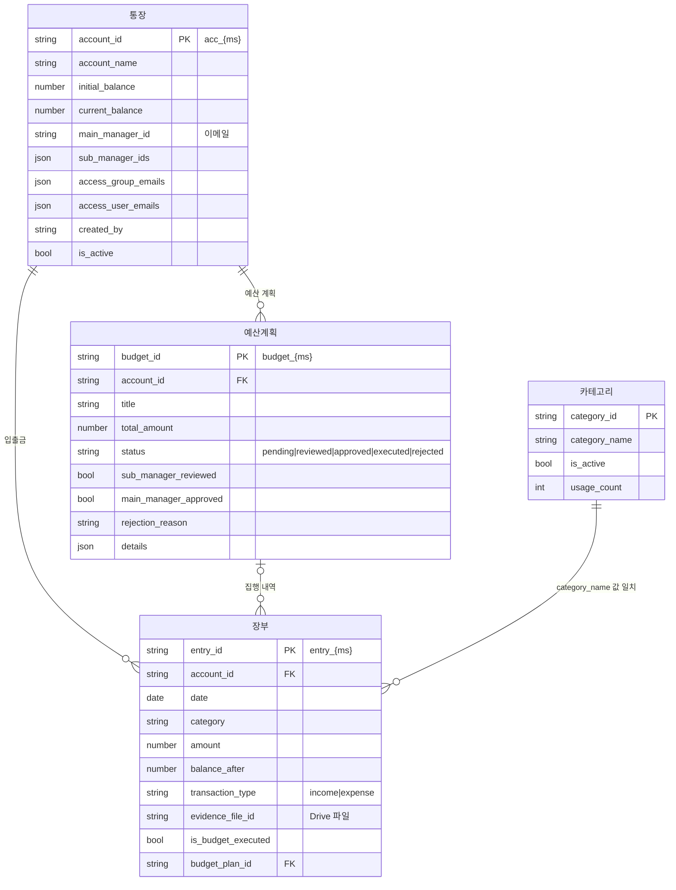
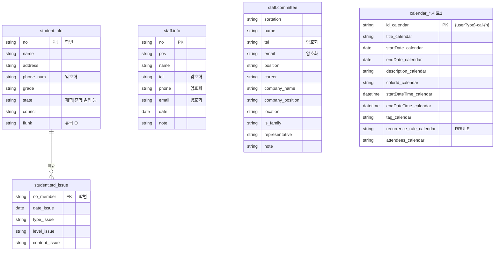

# Hot Potato ERP 데이터 모델 (ERD)

> 개발 단계: **③ 설계** · 산출물: ERD, 데이터 저장 구조
> 기준: `main` 브랜치 `ffed6c7` (2025-12-01)

이 시스템은 별도 DB 서버 없이 **Google Sheets를 데이터베이스로** 사용합니다.
스프레드시트 파일 하나가 "DB", 그 안의 시트(탭) 하나가 "테이블"이고, 1행이 레코드입니다.
파일은 Google Drive 폴더 트리에 놓이고, 프론트엔드는 파일 **이름**으로 ID를 찾아 접근합니다.

## 1. 저장소 한눈에 보기

| 스프레드시트 | Drive 위치 | 만드는 쪽 | 읽고 쓰는 쪽 | 내용 |
|---|---|---|---|---|
| `hp_member` | `ROOT/` (아래 주 참고) | 초기 세팅(GAS) | Apps Script 전용 | 회원, 관리자 키, 그룹 처리 로그 |
| `notice` | `ROOT/` | 초기 세팅 | Apps Script | 공지사항 |
| `워크플로우_관리` | `ROOT/` | 초기 세팅 또는 첫 결재 요청 시 | Apps Script | 결재 문서, 결재 이력, 결재선 템플릿 |
| `static_tag` | `ROOT/문서/` | 초기 세팅 | Apps Script | 공용 문서 태그 |
| `calendar_*` (5종) | 역할별 폴더 | 초기 세팅 | 프론트 직접(papyrus-db) | 역할별 일정 |
| `student` | `ROOT/집행부/` | 초기 세팅 | 프론트 직접 + GAS | 학생 정보, 학생 이슈 |
| `staff` | `ROOT/조교/` | 초기 세팅 | 프론트 직접 | 교직원, 위원회 |
| `{장부명}_장부` | `ROOT/회계/{장부명}/` | GAS `createLedger` | 생성은 GAS, 데이터는 프론트 직접 | 통장, 장부, 예산계획, 카테고리 |
| `hp_potato_DB` | **각 사용자 개인 드라이브** | 프론트 | 프론트 직접 | 즐겨찾기, 개인 태그, 시간표, 대시보드 위젯 |

- `ROOT`는 Drive 루트의 `hot potato` 폴더입니다(스크립트 속성 `ROOT_FOLDER_NAME`, 프론트 `VITE_ROOT_FOLDER_NAME`).
- `hp_member`는 초기 세팅이 `ROOT/`에 만들지만, Apps Script는 **스크립트에 연결된(컨테이너 바인딩) 스프레드시트**를 먼저 쓰고, 없으면 스크립트 속성 `SPREADSHEET_ID`로 엽니다(`SpreadsheetCore.gs`의 `getHpMemberSpreadsheet`). 두 파일이 다를 수 있으니 운영 시 하나로 맞춰야 합니다.
- 스프레드시트·시트 이름의 기본값은 프론트 `src/config/environment.ts`와 Apps Script 스크립트 속성(`InitialSetup.gs`의 `setScriptProperties`)에 따로 정의되어 있습니다.

데이터 접근 경로는 두 가지입니다. 이유는 [ADR-003](./ADR.md#adr-003-데이터-접근-경로를-두-갈래로-나눈다)에 있습니다.

1. **Apps Script 경유** — 회원·공지·결재·문서처럼 권한 검사나 Drive 조작이 필요한 데이터
2. **브라우저에서 Sheets API 직접 호출** — 캘린더·학생·교직원·장부 데이터처럼 조회가 잦고 Drive 공유 권한으로 접근을 통제할 수 있는 데이터

## 2. ERD

Sheets에는 FK 제약이 없으므로, 아래 관계는 **값이 일치하는 열**을 뜻합니다. 무결성은 애플리케이션 코드가 지킵니다.

### 2.1 회원 · 공지 · 결재



- ERD에는 주요 열만 적었습니다. 전체 헤더는 아래와 같습니다(`InitialSetup.gs`).
  - `workflow_documents`(22열): `workflow_id, workflow_type, document_id, document_title, document_url, workflow_document_id, workflow_document_title, workflow_document_url, attached_document_id, attached_document_title, attached_document_url, requester_email, requester_name, workflow_status, workflow_request_date, current_review_step, current_payment_step, review_line, payment_line, workflow_complete_date, created_at, updated_at`
  - `workflow_history`(16열): `history_id, workflow_id, document_id, document_title, line_type, step_number, action_type, actor_email, actor_name, actor_position, action_date, opinion, reject_reason, previous_status, new_status, processing_time`
  - `workflow_templates`(10열): `template_id, template_name, document_tag, review_line, payment_line, is_default, created_date, updated_date, created_by, description`
- `group_management_log`의 실제 헤더는 한글입니다: `학번, 사용자 이메일, 사용자 이름, 그룹스 이메일, 그룹스 이름, 그룹스 역할, 상태, 승인일`. ERD 문법상 영문 이름으로 적었습니다. 시트는 첫 로그를 쓸 때 생성됩니다(`GroupManagement.gs`).
- `admin_keys`는 초기 세팅이 만들지 않습니다. 시트가 미리 있어야 키 갱신(`KeyGeneration.gs`의 `updateAdminKey`)이 동작하며, 갱신할 때마다 시트를 비우고 헤더와 2행을 다시 씁니다.

### 2.2 회계 장부 (장부 1개 = 스프레드시트 1개)



시트 헤더는 `AccountingManagement.gs`의 `createAccountingSheets`가 씁니다.

| 시트 | 열 |
|---|---|
| `통장` (11열) | `account_id, account_name, initial_balance, current_balance, main_manager_id, sub_manager_ids, access_group_emails, access_user_emails, created_by, created_date, is_active` |
| `장부` (15열) | `entry_id, account_id, date, category, description, amount, balance_after, source, transaction_type, evidence_file_id, evidence_file_name, created_by, created_date, is_budget_executed, budget_plan_id` |
| `예산계획` (15열) | `budget_id, account_id, title, total_amount, requested_date, planned_execution_date, status, sub_manager_reviewed, sub_manager_review_date, main_manager_approved, main_manager_approval_date, executed_date, created_by, rejection_reason, details` |
| `카테고리` (7열) | `category_id, category_name, description, created_by, created_date, is_active, usage_count` |

### 2.3 학생 · 교직원 · 캘린더



- 학생 시트는 열 **순서**로 읽습니다(`papyrusManager.ts`, A~H). 반면 Apps Script의 유급·학년 처리(`StudentManagement.gs`)는 헤더 이름으로 열을 찾고, `flunk` 열이 없으면 새로 추가합니다.
- 캘린더 스프레드시트 5종: `calendar_professor`, `calendar_council`, `calendar_ADprofessor`, `calendar_supp`, `calendar_student`. 행은 A~K 11열을 그대로 씁니다.

### 2.4 개인 설정 (`hp_potato_DB`)

`hp_potato_DB`(사용자 개인 드라이브, `VITE_PERSONAL_CONFIG_FILE_NAME`)는 다른 엔터티와 관계가 없는 독립 저장소입니다. `personalConfigManager.ts`가 처음 로그인할 때 만듭니다.

| 시트 | 열 | 용도 |
|---|---|---|
| `favorite` | `type, favorite` | 템플릿 즐겨찾기 |
| `tag` | `tag` | 개인 태그 |
| `user_custom` | `dashboard, menu` | 사용자 화면 설정 |
| `schedule` | `no, title, date, startTime, endTime, description, color` | 개인 시간표 |
| `dashboard` | `widget_id, widget_type, widget_order, widget_config` | 대시보드 위젯 배치 |

## 3. 시트를 쓰지 않는 메타데이터

일부 정보는 시트 대신 **Drive 파일 속성(`properties`)**에 저장합니다.

| 대상 | 속성 | 근거 |
|---|---|---|
| 공유 양식 (`문서/양식`) | `description, tag, creatorEmail, createdDate` | `appScript/DocumentTemplates.gs` |
| 업로드한 공유 문서 (`문서/공유 문서`) | `creator, creatorEmail, createdDate, tag` | `appScript/DocumentCreation.gs` (`uploadSharedDocument`) |
| 개인 양식 (`문서/개인 양식`) | `tag` | `appScript/StaticTagManager.gs` |

태그 이름을 바꾸거나 지우면 `static_tag` 시트와 해당 파일들의 `properties.tag`를 함께 갱신합니다.

## 4. Drive 폴더 구조

### 4.1 조직 공용 폴더 (Apps Script 배포자 드라이브)

`initializeSystem()`(`appScript/InitialSetup.gs`)이 만듭니다. 공유 드라이브(Shared Drive)가 아니라 **배포자의 내 드라이브**에 생성됩니다.

```text
hot potato/                       ← ROOT (스크립트 속성 ROOT_FOLDER_NAME)
├── hp_member
├── notice
├── 워크플로우_관리
├── 공지사항문서/                  ← 생성만 됨 (아래 6절)
├── 회계/
│   └── {장부명}/                  ← createLedger 시 생성
│       ├── {장부명}_장부
│       └── 증빙/                  ← 증빙 파일
├── 결재문서/                      ← 생성만 됨 (아래 6절)
├── 결재 문서/                     ← 결재용 Google Docs (첫 결재 요청 시 생성)
├── 채팅/                          ← 생성만 됨
├── 문서/
│   ├── static_tag
│   ├── 양식/                      ← 공유 양식
│   ├── 공유 문서/
│   ├── 개인 문서/
│   └── 개인 양식/
├── 집행부/   ├── calendar_council
│             └── student
├── 겸임교원/ └── calendar_ADprofessor
├── 학생/     └── calendar_student
└── 조교/     ├── calendar_supp
              └── staff
```

- `calendar_professor`는 `ROOT/교수/`에 만들도록 설정되어 있지만, 초기 세팅이 `교수` 폴더를 만들지 않아 생성 단계가 건너뜁니다. 운영자가 폴더와 스프레드시트를 직접 만들어야 합니다.
- 공지 본문 이미지와 첨부 파일은 위 트리가 아니라 **코드에 고정된 Drive 폴더 ID**로 올라갑니다(`AnnouncementManagement.gs`, `papyrusManager.ts`).

### 4.2 사용자 개인 폴더 (각 사용자 드라이브)

프론트가 필요할 때 만듭니다(`personalConfigManager.ts`, `googleSheetUtils.ts`).

```text
hot potato/
├── hp_potato_DB
└── 문서/
    ├── 개인 문서/
    └── 개인 양식/
```

## 5. 식별자 · 저장 규칙

- **ID 생성:** `{접두어}_{epoch ms}[_{rand}]` 형식입니다 (`wf_`, `hist_`, `tpl_`, `acc_`, `entry_`, `budget_`). 공지 번호만 기존 최대값 + 1, 캘린더는 `{userType}-cal-{n}`입니다.
- **개인정보 암호화:** 회원 이메일, 공지 작성자 이메일, 학생 연락처, 교직원·위원회 연락처와 이메일은 암호화해서 저장합니다. 원칙과 한계는 [SECURITY.md](./SECURITY.md)에 정리했습니다.
- **JSON 열:** 결재선(`review_line`, `payment_line`), 공지 공개 범위(`access_rights`), 첨부(`file_notice`), 통장 권한 목록, 예산 상세(`details`)는 JSON 문자열로 저장합니다.
- **O/X 플래그:** 승인(`Approval`), 관리자(`is_admin`), 유급(`flunk`, `O` 또는 빈칸), 고정 공지(`fix_notice`)는 문자 값으로 표시합니다.
- **스프레드시트 ID 해석:** 프론트가 `getSpreadsheetIds` 액션에 이름 배열을 보내면, Apps Script가 Drive 검색(`Drive.Files.list`, 이름 + 스프레드시트 형식)으로 **배포자가 접근할 수 있는 파일 중 이름이 일치하는 첫 파일**의 ID를 돌려줍니다. ROOT 폴더로 범위를 좁히지 않으므로, 같은 이름의 파일이 Drive 어디에든 있으면 엉뚱한 파일을 잡을 수 있습니다.

## 6. 알려진 불일치 (정리 대상)

코드를 기준으로 문서를 쓰면서 발견한 항목입니다. 이 저장소는 `ffed6c7`에서 동결되었고, 정리는 [hot_potato_remake](https://github.com/semicolon213/hot_potato_remake)에서 이어집니다. 기준 시점의 백로그는 [STATUS.md](./STATUS.md)에 있습니다.

| 항목 | 내용 | 위치 |
|---|---|---|
| 예산계획 열 순서 | GAS 헤더(15열)와 프론트 쓰기(16열: `modification_date`, `sub_manager_reviews` 포함)의 열 구성이 다르고, 상태 갱신은 G열(GAS 헤더의 `status`)에 씁니다 | `AccountingManagement.gs`, `src/utils/database/accountingBudgetManager.ts` |
| 카테고리 조회 | `getAccountingCategories`가 `카테고리` 시트가 아니라 첫 시트를 읽습니다 | `AccountingManagement.gs` |
| 결재 문서 폴더 이름 | 초기 세팅은 `결재문서`를 만들고, 결재 코드는 `결재 문서`(공백 포함)를 찾거나 새로 만듭니다 | `InitialSetup.gs`, `DocumentWorkflow.gs` |
| `calendar_professor` | 상위 폴더 `교수`가 생성 목록에 없어 초기 세팅에서 빠집니다 | `InitialSetup.gs` |
| 미사용 폴더 | `공지사항문서/`, `채팅/`, `결재문서/`는 만들지만 쓰는 코드가 없습니다 | `InitialSetup.gs` |
| `admin_keys` 시트 | 초기 세팅이 만들지 않습니다. 백업 시트도 없을 때의 생성 경로가 정상 동작하지 않습니다 | `InitialSetup.gs`, `KeyGeneration.gs` |
| `hp_member` 위치 | 초기 세팅이 만드는 파일과 Apps Script가 여는 파일(바인딩 또는 `SPREADSHEET_ID`)이 다를 수 있습니다 | `InitialSetup.gs`, `SpreadsheetCore.gs` |
| 결재 상태 표기 | 백엔드는 `결재중/결재완료/결재보류`를 쓰지만 프론트 타입·상태 색상 매핑은 `결제중/결제완료`로 적혀 있고 `결재보류`가 없습니다 | `src/types/documents.ts`, `WorkflowManagement.tsx` |
| 레거시 문서 시트 | `학생_문서관리` 등 역할별 문서관리 시트는 생성되지 않지만 문서 목록·삭제 코드가 참조합니다 | `CONFIG.gs`, `DocumentSpreadsheet.gs` |
| 레거시 이름 | 프론트의 `VITE_HOT_POTATO_DB_SPREADSHEET_NAME`(`hot_potato_DB`), `document_template` 시트, 게시판의 `BOARD_SHEET_NAME`은 현재 만들어지는 저장소와 대응하지 않습니다 | `src/config/environment.ts`, `papyrusManager.ts`, `src/pages/Board` |
| `getSheetIdByName` 중복 정의 | 같은 이름의 전역 함수가 두 파일에 있습니다(동작은 같음) | `SpreadsheetUtils.gs`, `DocumentSpreadsheet.gs` |
