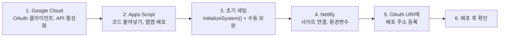

# Hot Potato ERP 배포 가이드

> 개발 단계: **④ 구조 생성 / ⑤ 구현** · 산출물: 인프라 구성, 빌드·배포 절차
> 대상: 새 환경을 처음부터 세팅하거나, 운영 중인 서비스에 변경을 배포하는 사람
> 기준: `main` @ `ffed6c7` (2025-12-01). 이후 개발은 [hot_potato_remake](https://github.com/semicolon213/hot_potato_remake)에서 이어집니다.
> 구성도는 [ARCHITECTURE.md](./ARCHITECTURE.md)를 보세요.

## 0. 전체 순서



처음 세팅할 때만 1~6을 모두 합니다. 이후 변경 배포는 [§7](#7-변경-배포)만 보면 됩니다.

## 1. Google Cloud Console

1. [Google Cloud Console](https://console.cloud.google.com/)에서 프로젝트를 만듭니다.
2. **API 및 서비스 → OAuth 동의 화면**: 외부(또는 조직 내부) 유형, 앱 이름·지원 이메일을 입력합니다.
3. **사용자 인증 정보 → OAuth 클라이언트 ID**: 유형은 **웹 애플리케이션**입니다.
   - 승인된 JavaScript 원본과 리디렉션 URI에 같은 값을 넣습니다: `http://localhost:5173`, 배포 주소(5단계에서 추가)
4. **라이브러리**에서 아래 API를 사용 설정합니다: Google Sheets API, Google Drive API, Google Docs API, Google Calendar API, Gmail API

앱이 요청하는 OAuth 범위(`src/hooks/features/auth/useAuth.ts`): `calendar.events`, `calendar.readonly`, `spreadsheets`, `gmail.compose`, `drive`, `documents`, `profile`, `email`

## 2. Apps Script

### 2.1 프로젝트 만들기와 코드 올리기

이 저장소에는 clasp 설정(`.clasp.json`)과 매니페스트(`appsscript.json`)가 없습니다. 편집기에 직접 올립니다.

1. [script.google.com](https://script.google.com/)에서 **새 프로젝트**를 만듭니다. 이 프로젝트를 소유한 계정이 **배포 계정**이 되고, 모든 공용 데이터가 이 계정 드라이브에 생깁니다.
2. `appScript/` 폴더의 `.gs` 파일 38개를 같은 이름으로 만들어 내용을 붙여 넣습니다. `Test*.gs`, `*Verification.gs`, `DocumentTests.gs`는 운영에 필요하지 않지만 함께 두어도 동작에는 영향이 없습니다.
3. 왼쪽 **서비스 → +** 에서 **Drive API** 고급 서비스를 추가합니다. 코드가 `Drive.Files.list/create/copy/update`(v3 형식)를 씁니다. 추가하지 않으면 스프레드시트 ID 조회와 문서 기능이 실패합니다.

> clasp을 쓰고 싶다면 각자 `.clasp.json`(`{"scriptId": "...", "rootDir": "appScript"}`)을 만들고 `clasp push`로 올릴 수 있습니다. 다만 저장소에는 매니페스트가 없으므로 고급 서비스 설정은 편집기에서 직접 해야 합니다.

### 2.2 웹앱 배포

1. 편집기에서 **배포 → 새 배포 → 웹 앱**을 고릅니다.
2. **실행 사용자: 나(배포 계정)**, **액세스 권한: 모든 사용자**로 둡니다. Netlify 프록시가 로그인 정보 없이 호출하고, 백엔드는 배포 계정의 드라이브를 읽기 때문입니다.
3. 배포 후 나오는 **웹 앱 URL**(`.../exec`)을 복사해 둡니다. 4단계에서 씁니다.
4. 첫 실행 때 권한 승인 창이 뜨면 배포 계정으로 승인합니다.
5. 브라우저에서 웹 앱 URL을 열어 `{"success":true,"message":"Hot Potato App Script is running", ...}`이 나오면 배포가 살아 있습니다(`doGet`).

> 이후 코드를 바꿀 때는 **새 배포를 만들지 말고** "배포 관리 → 기존 배포 편집 → 새 버전"으로 올립니다. 새 배포를 만들면 URL이 바뀌어 Netlify 환경변수도 바꿔야 합니다.

## 3. 초기 세팅 (Drive 폴더·시트 생성)

### 3.1 `initializeSystem` 실행

1. 편집기에서 `InitialSetup.gs`를 열고 `initializeSystem`을 실행합니다.
2. 배포 계정의 내 드라이브에 아래가 생깁니다. 같은 이름이 이미 있으면 새로 만들지 않고 그대로 씁니다.

   | 위치 | 폴더 | 스프레드시트 |
   |---|---|---|
   | `hot potato/` | `공지사항문서`, `회계`, `결재문서`, `집행부`, `채팅`, `문서`, `겸임교원`, `학생`, `조교` | `notice`, `hp_member`(`user` 시트), `워크플로우_관리` |
   | `hot potato/문서/` | `양식`, `개인 문서`, `개인 양식`, `공유 문서` | `static_tag` |
   | `hot potato/집행부/` | | `calendar_council`, `student` |
   | `hot potato/겸임교원/` | | `calendar_ADprofessor` |
   | `hot potato/학생/` | | `calendar_student` |
   | `hot potato/조교/` | | `calendar_supp`, `staff` |

3. 스크립트 속성 중 아래 값이 비어 있으면 채웁니다. 이미 있는 값은 덮어쓰지 않습니다: `ROOT_FOLDER_NAME`, `DOCUMENT_FOLDER_NAME`, `TEMPLATE_FOLDER_NAME`, `SHARED_DOCUMENT_FOLDER_NAME`, `PERSONAL_TEMPLATE_FOLDER_NAME`, `SHEET_NAME_USER`, `SHEET_NAME_ADMIN_KEYS`, `NOTICE_SHEET_NAME`, `STATIC_TAG_SPREADSHEET_NAME`, `STATIC_TAG_SHEET_NAME`, `WORKFLOW_SPREADSHEET_NAME`
4. **실행 로그를 꼭 확인합니다.** 개별 폴더·시트 생성이 실패해도 반환값은 `success:true`로 나옵니다.

> **주의:** 이미 있는 스프레드시트에 다시 실행하면, 1행 헤더가 코드의 헤더와 다를 때 **1행을 코드의 헤더로 덮어씁니다.** 운영 중에는 헤더를 손으로 바꾸지 말고, 재실행 전에 사본을 만들어 둡니다.

### 3.2 `initializeSystem`이 하지 않는 일 (수동)

| 할 일 | 이유 | 방법 |
|---|---|---|
| `calendar_professor` 만들기 | 코드가 `hot potato/교수` 폴더에 만들려고 하지만 폴더 생성 목록에 `교수`가 없어 건너뜁니다(로그에 `⚠️ 폴더를 찾을 수 없음: hot potato/교수`). 폴더를 직접 만든 뒤 다시 실행해도 같습니다 | `hot potato/교수/` 폴더를 직접 만들고, `calendar_student`를 복사해 그 폴더로 옮긴 뒤 이름을 `calendar_professor`로 바꾸고 데이터 행을 지움 |
| `SPREADSHEET_ID` 스크립트 속성 | 백엔드는 `hp_member`를 "스크립트가 붙은 스프레드시트" 또는 이 속성으로 찾습니다. 독립형 프로젝트에서는 이 속성이 없으면 회원 기능이 모두 실패합니다 | **프로젝트 설정 → 스크립트 속성**에 `SPREADSHEET_ID` = `hp_member`의 ID |
| `hp_member`에 `admin_keys` 시트 추가 | 키 갱신 코드가 이 시트가 없으면 오류를 냅니다 | 빈 시트를 `admin_keys` 이름으로 추가. 헤더는 갱신할 때 코드가 씁니다 |
| 관리자 키 일일 갱신 트리거 | 자동으로 만들지 않습니다 | **트리거 → 트리거 추가 → `handleDailyKeyUpdate`, 시간 기반, 일 단위**. 처음 한 번은 편집기에서 직접 실행 |
| 역할 폴더 공유 | 폴더·시트를 배포 계정 소유로 만들 뿐 공유하지 않습니다. 캘린더·학생·교직원 시트는 사용자 브라우저가 사용자 권한으로 직접 읽습니다 | `집행부`, `겸임교원`, `학생`, `조교`, `교수` 폴더를 해당 역할의 Google 그룹에 공유 |
| 역할별 그룹 이메일(서버) | `CONFIG.gs`의 `GROUP_ROLE_MAPPING`에 코드로 적혀 있습니다 | 다른 그룹을 쓰려면 이 객체를 고쳐 다시 배포 |

`hp_member`는 배포 계정 외에 공유하지 않습니다. 이후 사용자 사전 등록과 첫 관리자 만들기는 [OPERATOR_MANUAL.md](./OPERATOR_MANUAL.md)를 따릅니다.

## 4. Netlify

1. Netlify에서 **Add new site → Import an existing project**로 GitHub 저장소를 연결합니다. 배포 브랜치는 `main`입니다.
2. 빌드 설정은 `netlify.toml`을 따릅니다.

   | 항목 | 값 |
   |---|---|
   | Build command | `npm run build` |
   | Publish directory | `dist` |
   | Functions | `netlify/functions` |
   | Node | 18 (`NODE_VERSION`) |

3. **Site configuration → Environment variables**에 아래 값을 넣습니다.

   | 변수 | 필수 | 쓰는 곳 |
   |---|---|---|
   | `VITE_APP_SCRIPT_URL` | ✅ | 프록시 Function(`netlify/functions/proxy.js`)이 먼저 읽는 값. 빌드 시 번들에도 들어가 학생·교직원 화면 일부가 직접 씀 |
   | `APP_SCRIPT_URL` | — | 프록시가 `VITE_APP_SCRIPT_URL`이 없을 때 읽는 대체 값 |
   | `VITE_GOOGLE_CLIENT_ID` | ✅ | 빌드 시 번들에 포함. 로그인 URL 생성 |
   | `VITE_GROUP_EMAIL_*` | 권장 | 문서·장부를 그룹에 공유할 때 씀 |
   | 그 밖의 `VITE_*` 이름 변수 | 기본값을 바꿀 때 | [GETTING_STARTED.md §3](./GETTING_STARTED.md#3-환경변수-env) 참고 |

   > `VITE_*` 값은 빌드할 때 번들에 들어가므로 **공개 값**입니다. 비밀 값을 `VITE_`로 시작하는 이름에 넣지 마세요.
   > 환경변수를 바꾼 뒤에는 **Deploys → Trigger deploy → Clear cache and deploy site**로 다시 빌드해야 반영됩니다.

4. `netlify.toml`에는 리다이렉트 규칙이 없습니다. 앱은 루트 경로 하나만 쓰고 화면은 `?page=` 쿼리로 바꿉니다.

## 5. OAuth에 배포 주소 등록

Google Cloud Console의 OAuth 클라이언트에서 **승인된 JavaScript 원본**과 **승인된 리디렉션 URI**에 배포 주소(예: `https://<사이트>.netlify.app`)를 추가합니다. 앱은 리디렉션 URI로 `window.location.origin`을 쓰므로, 끝에 `/`를 붙이지 않은 같은 주소를 넣습니다.

## 6. 배포 후 확인

- [ ] 사이트 접속 시 로그인 화면이 뜬다
- [ ] Google 로그인 후 앱으로 돌아온다 (`redirect_uri_mismatch`가 없다)
- [ ] 회원가입 화면, 승인 대기 화면 또는 대시보드가 뜬다
- [ ] 개발자 도구 Network 탭에서 `/.netlify/functions/proxy` 응답이 `200`이고 본문이 `success:true`다
- [ ] Console에 `⚠️ 찾지 못한 스프레드시트:` 경고가 없다
- [ ] 공지사항과 학사 일정 데이터가 보인다

문제가 생기면 [RUNBOOK.md](./RUNBOOK.md)를 보세요.

## 7. 변경 배포

| 바꾼 것 | 배포 방법 |
|---|---|
| 프론트엔드 (`src/`, `public/`) | `main`에 병합 → Netlify 자동 빌드·배포 |
| 프록시 (`netlify/functions/`) | 위와 같음 |
| Apps Script (`appScript/`) | 편집기에 바뀐 파일 붙여넣기(또는 `clasp push`) → **배포 관리 → 기존 배포 편집 → 새 버전** (URL 유지) |
| 환경변수 | Netlify 대시보드에서 수정 → Clear cache and deploy |
| 스크립트 속성 | Apps Script **프로젝트 설정 → 스크립트 속성** |

**백엔드를 먼저, 프론트엔드를 나중에** 배포합니다. 새 액션을 쓰는 프론트가 먼저 나가면 `알 수 없는 액션입니다` 오류가 납니다.

### 롤백

| 대상 | 방법 |
|---|---|
| Netlify | **Deploys**에서 이전 배포를 골라 **Publish deploy** |
| Apps Script | **배포 관리 → 기존 배포 편집**에서 이전 버전 선택 |

## 8. Electron (선택)

```bash
npm run electron:build   # 웹 빌드 후 electron-builder 실행 → dist-electron/
```

- 산출물: Windows NSIS, macOS dmg, Linux AppImage (`package.json`의 `build` 항목, productName `HP ERP`)
- Windows 아이콘으로 `public/logo.ico`를 지정하지만 이 파일은 저장소에 없습니다. Windows 패키징 전에 확인합니다.
- 패키징된 앱은 `dist/index.html`을 `file://`로 엽니다. 로그인은 `window.location.origin`을 리디렉션 URI로 쓰므로 웹과 같은 방식으로는 동작하지 않습니다. 기준 시점의 공식 배포 채널은 웹입니다.

## 9. CI (GitHub Actions)

`.github/workflows/`에 워크플로 2개가 있습니다. Netlify 배포와는 별개로 돕니다.

| 워크플로 | 실행 시점 | 하는 일 |
|---|---|---|
| `ci.yml` (CI/CD Pipeline) | `main`·`develop` push, PR | 아래 4개 job |
| `electron-build.yml` (Electron Build) | `v*` 태그 push, 수동 실행 | Windows·macOS·Ubuntu에서 `electron:build`, 아티팩트 업로드, Ubuntu job에서 GitHub Release 생성 |

`ci.yml`의 job:

| job | Node | 내용 | 실패 시 |
|---|---|---|---|
| `quality` | 22.x | `npm ci` → `type-check` → React 19 의존성 확인(`npm ls`) → ESLint(`--max-warnings 1000`) → `npm audit --audit-level high` | ESLint와 audit는 `continue-on-error`라 막지 않음 |
| `test` | 20.x, 22.x | `npm run test:ci` (테스트용 `VITE_*` 값 주입) → Codecov 업로드 | 테스트 실패 시 중단 |
| `performance` | 22.x | `npm run build` → `bundle-size` → `dist/` 아티팩트 업로드 | 빌드 실패 시 중단 |
| `deploy` | — | `main`일 때만. 메시지만 출력하는 자리표시자이며 실제 배포는 하지 않음 | — |

`electron-build.yml` 참고:

- 빌드 환경변수는 저장소 Secrets(`VITE_GOOGLE_CLIENT_ID`, `VITE_APP_SCRIPT_URL` 등)에서 읽습니다.
- 아티팩트 업로드에 `actions/upload-artifact@v3`를 씁니다. GitHub에서 지원이 끝난 버전이라 그대로는 실패할 수 있습니다.
- Release는 Ubuntu job의 `dist-electron/`에서 만들므로 실제로 올라가는 파일은 AppImage뿐입니다. Windows·macOS 산출물은 각 job의 아티팩트에서 받습니다.

병합 전에 로컬에서 아래 명령을 돌리면 CI의 핵심 검사와 같습니다.

```bash
npm run build && npm run test:ci && npm run lint
```
