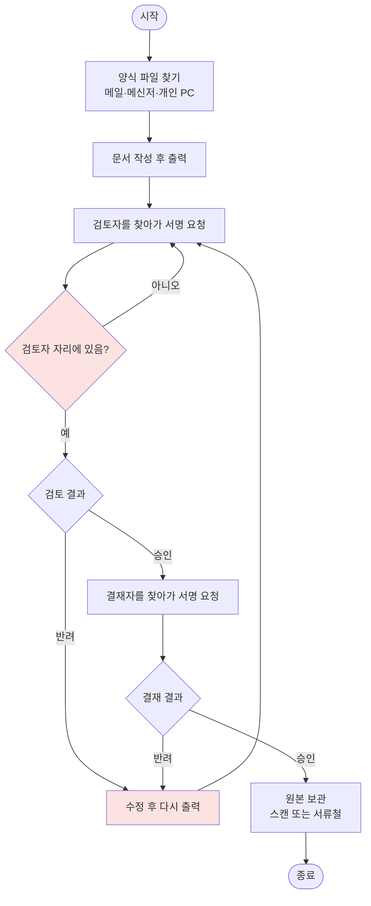

# Hot Potato ERP 문제 정의서

> 개발 단계: **① 문제 정의** · 산출물: 프로젝트 제안 / 문제 정의서 / 범위 정의서
> 관련 다이어그램: Activity Diagram (현행 업무 흐름)
> 이 저장소는 `main` @ `ffed6c7`(2025-12-01)에서 멈춰 있습니다. 이후 개발은 [hot_potato_remake](https://github.com/semicolon213/hot_potato_remake)에서 이어집니다.

## 1. 배경

학과 운영 업무(문서, 결재, 공지, 일정, 학생회비 장부, 학생 정보)는 **별도 시스템 없이 아날로그 방식**으로 처리되고 있었습니다.
양식은 파일로 주고받고, 결재는 출력한 종이에 서명을 받고, 공지와 일정은 메신저 단체방에 흩어져 있었습니다.

학과 구성원은 이미 모두 Google 계정(Workspace)을 쓰고 있었습니다. 그래서 새 서버와 DB를 들이는 대신 **이미 쓰고 있는 Google Drive·Sheets·Calendar 위에 업무 흐름을 얹는 것**을 해결 방향으로 잡았습니다.

## 2. 문제 정의

| # | 문제 | 현재 방식 | 결과 |
|---|---|---|---|
| P1 | 결재 진행 상황이 보이지 않음 | 문서를 출력해 검토자·결재자를 직접 찾아가 서명 | 누가 어디서 멈췄는지 모르고, 반려되면 처음부터 다시 출력 |
| P2 | 양식과 문서가 흩어져 있음 | 개인 PC, 메일, 메신저로 파일 공유 | 최신 양식을 찾기 어렵고 버전이 섞임 |
| P3 | 공지와 일정 전달이 누락됨 | 메신저 단체방, 구두 전달 | 지난 공지를 찾기 어렵고, 대상(학년·역할)별 전달이 안 됨 |
| P4 | 학생회비 장부를 확인하기 어려움 | 엑셀·수기 장부, 영수증 실물 보관 | 잔액과 증빙을 맞춰 보려면 담당자에게 물어야 함 |
| P5 | 학생·교직원 정보가 분산됨 | 담당자별 엑셀 파일 | 학년·학적 현황을 매 학기 다시 취합 |
| P6 | 권한 구분이 없음 | 파일 공유 링크 | 학생 개인정보와 회계 자료가 필요 이상으로 노출될 위험 |

### 현행(As-Is) 결재 흐름

P1을 가장 큰 문제로 봤습니다. 현재 흐름은 다음과 같습니다.

빨간 지점이 병목입니다. 결재자를 기다리는 시간, 반려될 때마다 반복되는 출력과 대면 요청이 문제입니다.

## 3. 목표

| 목표 | 해결할 문제 | 구현 방향 |
|---|---|---|
| G1. 결재를 온라인으로 처리하고 상태를 추적한다 | P1 | 검토·결재 다단계 결재선, 상태와 이력 기록 |
| G2. 양식과 문서를 한 곳에서 관리한다 | P2 | 공유·개인 양식, 태그, 양식에서 문서 바로 생성 |
| G3. 대상별 공지와 통합 일정을 제공한다 | P3 | 역할·개인 단위 공개 범위, 역할별 캘린더 통합 |
| G4. 장부와 증빙을 함께 관리한다 | P4 | 통장·장부·예산계획, 증빙 파일 연결 |
| G5. 학적·인사 정보를 한 곳에서 관리한다 | P5 | 학생·학생회·교직원·위원회 관리, 유급 표시, 연 1회 학년 자동 갱신 |
| G6. 역할에 따라 접근을 나눈다 | P6 | 가입 승인제, 5개 역할 + 관리자, 개인정보 암호화 저장 |

## 4. 성공 지표 (KPI)

아날로그 방식이라 **도입 전 수치(기준값)가 없습니다.** 그래서 시스템이 스스로 기록하는 데이터로 측정할 수 있는 지표를 정하고, 운영 첫 학기 값을 기준값으로 삼습니다.

| KPI | 정의 | 측정 데이터 | 목표 |
|---|---|---|---|
| 결재 처리 시간 | 요청부터 최종 결재까지 걸린 평균 시간 | `workflow_documents.workflow_request_date` ~ `workflow_complete_date` | 첫 학기 기준값 대비 감소 |
| 결재 단계별 대기 시간 | 각 단계에서 머무른 시간 | `workflow_history.processing_time` | 병목 단계 식별 |
| 온라인 결재 전환율 | 학과 결재 중 시스템으로 처리한 비율 | 결재 건수 / 학과 전체 결재 건수 | 증가 |
| 장부 증빙 첨부율 | 지출 내역 중 증빙 파일이 연결된 비율 | `장부.evidence_file_id` 유무 | 100% |
| 가입 승인 대기 시간 | 가입 요청부터 승인까지 걸린 시간 | `user.approval_date` | 단축 |
| 서비스 가용성 | 정상 응답 비율 | Netlify·Apps Script 로그 | 학기 중 상시 사용 가능 |

이 저장소의 기준 시점까지 KPI를 실제로 수집한 기록은 없습니다.

## 5. 범위

### 포함

- Google 계정 로그인, 가입 신청과 관리자 승인, 역할별 접근 제어
- 대시보드(위젯), 공지사항, 문서·양식 관리, 결재
- 캘린더(역할별 통합), 개인 시간표
- 회계(장부, 예산계획, 증빙)
- 학생 관리(학적, 학생회, 유급 표시, 연 1회 학년 자동 갱신), 교직원·위원회 관리
- 관리자 기능(사용자 승인, 관리자 키, 공지 고정 승인, 템플릿·태그 관리)
- Google 서비스 바로가기(Apps Script, Sheets, Docs, Gemini, Groups 화면을 앱 안에서 열기)
- 웹(Netlify) 배포, 데스크톱(Electron) 빌드

### 제외

- 학교 학사 시스템(수강, 성적) 연동
- 실제 결제·송금 처리 (장부는 기록만 함)
- 모바일 앱
- 학과 외부 사용자
- 자유게시판, 채팅, 회의록: 화면 코드(`src/pages/Board/`, `Chat.tsx`, `Proceedings.tsx`)는 있지만 메뉴에 연결하지 않음 ([STATUS.md](./STATUS.md))

졸업생 취업 정보 입력, 조교가 직접 실행하는 학년 갱신, 개인정보처리방침·이용약관 페이지는 이 저장소의 범위가 아니었고 [리메이크](https://github.com/semicolon213/hot_potato_remake)에서 추가되었습니다.

## 6. 제약 사항

| 구분 | 내용 | 설계에 준 영향 |
|---|---|---|
| 예산 | 서버·DB 운영비 없음 | 서버리스(Apps Script) + 무료 호스팅(Netlify) + Sheets를 DB로 사용 |
| 인력 | 학생 개발 팀(6명), 학기 중 개발 | 익숙한 React/TypeScript, 운영 부담이 적은 구성 |
| 플랫폼 | Google Workspace 의존 | Apps Script 실행 시간·호출 할당량 안에서 동작해야 함 |
| 운영 | 운영자가 학과 조교 | 초기 세팅과 장애 대응을 문서로 남겨야 함 ([RUNBOOK.md](./RUNBOOK.md)) |
| 개인정보 | 학생 연락처, 이메일 취급 | 암호화 저장. 개인정보처리방침·이용약관 게시는 기준 시점에 없음 |
