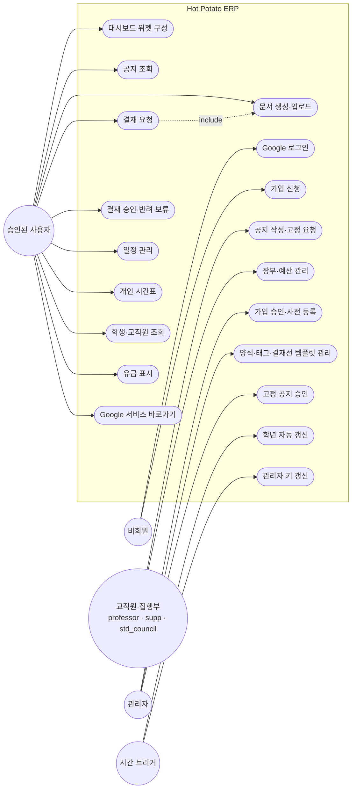

# Hot Potato ERP 소프트웨어 요구사항 명세서 (SRS)

> 개발 단계: **② 요구사항** · 산출물: SRS, 사용자 스토리, 용어 사전([GLOSSARY.md](./GLOSSARY.md))
> 관련 다이어그램: Use Case Diagram
> 문제와 범위는 [PROBLEM_DEFINITION.md](./PROBLEM_DEFINITION.md)를 먼저 읽어 주세요.
> 이 문서는 `main` @ `ffed6c7` 코드에 있는 기능을 기준으로 씁니다. 이후 요구사항은 [hot_potato_remake](https://github.com/semicolon213/hot_potato_remake/blob/main/docs/SRS.md)에서 관리합니다.

## 1. 사용자(액터)

| 액터 | 코드 값 | 설명 |
|---|---|---|
| 비회원 | — | Google 계정은 있지만 가입하지 않은 사람. 로그인과 가입 신청만 가능 |
| 학생 | `student` | 재학생 |
| 집행부(학생회) | `std_council` | 학생회 임원. 학생회비 장부 관리 |
| 조교 | `supp` | 학과 사무 담당 |
| 교수 | `professor` | 전임 교원 |
| 겸임교원 | `ad_professor` | 겸임 교원 |
| 관리자 | `is_admin = O` | 역할과 별개인 권한 플래그. 가입 승인, 키 관리, 고정 공지 승인 |
| 결재 참여자 | 동적 | 결재선에 지정된 검토자·결재자 |
| 장부 관리인 | 동적 | 통장의 주관리인·부관리인 |
| 시간 트리거 | — | Apps Script 시간 기반 트리거. 관리자 키 갱신, 매년 1월 학년 갱신 실행 |

## 2. Use Case 다이어그램

- 교직원·집행부, 관리자는 **승인된 사용자**의 기능을 모두 씁니다(일반화).
- 공지 작성은 학생을 제외한 승인 사용자, 회계 메뉴는 집행부·교수·조교에게 보입니다.
- 유급 표시는 학생 상세 화면에서 합니다. 화면 단위 역할 제한은 코드에서 확인하지 못했습니다.

## 3. 사용자 스토리

| ID | 사용자 스토리 | 우선순위 |
|---|---|---|
| US-01 | 학과 구성원으로서, Google 계정으로 로그인하고 싶다. 새 아이디를 만들지 않아도 되도록. | Must |
| US-02 | 관리자로서, 학번·이름을 미리 등록하고 가입 신청을 승인하고 싶다. 학과 구성원만 들어오도록. | Must |
| US-03 | 학생회 임원으로서, 결재 문서를 올리고 진행 상황을 보고 싶다. 교수님을 찾아다니지 않도록. | Must |
| US-04 | 교수로서, 내 차례인 결재만 모아 보고 승인·반려하고 싶다. | Must |
| US-05 | 조교로서, 공지를 역할·개인을 정해 올리고 싶다. 대상자만 보도록. | Must |
| US-06 | 학생으로서, 최신 양식으로 문서를 바로 만들고 싶다. 양식 파일을 찾아 헤매지 않도록. | Must |
| US-07 | 학생회 회계로서, 입출금과 증빙을 함께 기록하고 싶다. 잔액과 증빙을 한 화면에서 맞춰 보도록. | Must |
| US-08 | 구성원으로서, 내 역할에 맞는 학사 일정을 한 캘린더에서 보고 싶다. | Should |
| US-09 | 조교로서, 매년 학생 학년이 자동으로 올라가고 3학년은 졸업 처리되길 원한다. | Should |
| US-10 | 학생회 회계로서, 예산 계획을 올려 부관리인 검토와 주관리인 승인을 받고 싶다. | Should |
| US-11 | 사용자로서, 대시보드에 자주 보는 정보를 위젯으로 배치하고 싶다. | Could |
| US-12 | 학생으로서, 개인 시간표를 관리하고 싶다. | Could |
| US-13 | 구성원으로서, 자주 쓰는 Google 서비스를 앱 안에서 바로 열고 싶다. | Could |
| US-14 | 사용자로서, 웹과 같은 기능을 데스크톱 앱으로 쓰고 싶다. | Could |

## 4. 기능 요구사항

우선순위는 MoSCoW 기준입니다. **Must** = 없으면 시스템이 의미 없음, **Should** = 중요하지만 우회 가능, **Could** = 있으면 좋음, **Won't** = 이번 범위에서 제외.
구현 상태는 [STATUS.md](./STATUS.md)에서 관리합니다.

### 4.1 인증·회원 (AUTH)

| ID | 요구사항 | 우선순위 |
|---|---|---|
| FR-AUTH-01 | Google OAuth 2.0으로 로그인한다 | Must |
| FR-AUTH-02 | 최근 로그인한 계정을 기억하고 한 번에 다시 로그인한다 | Could |
| FR-AUTH-03 | 미가입 사용자는 학번·이름·가입유형을 입력해 가입을 신청한다. 사전 등록된 학번·이름과 일치해야 한다 | Must |
| FR-AUTH-04 | 관리자 키를 입력하면 관리자 권한으로 가입을 신청할 수 있다 | Must |
| FR-AUTH-05 | 승인 전 사용자는 승인 대기 화면만 본다 | Must |
| FR-AUTH-06 | 관리자는 학번·이름을 일괄 사전 등록한다 | Must |
| FR-AUTH-07 | 관리자는 가입 신청을 승인하거나 거부한다. 승인 시 역할에 맞는 Google 그룹에 추가한다 | Must |
| FR-AUTH-08 | 관리자 키는 매일 갱신되고, 관리자는 키를 메일로 받을 수 있다 | Should |
| FR-AUTH-09 | 30분 동안 활동이 없거나 토큰이 만료되면 로그아웃한다 | Should |
| FR-AUTH-10 | 사용자는 마이페이지에서 자기 가입 정보와 승인 상태를 본다 | Could |

### 4.2 대시보드 (DASH)

| ID | 요구사항 | 우선순위 |
|---|---|---|
| FR-DASH-01 | 위젯을 추가·삭제하고 드래그로 순서를 바꾼다 | Could |
| FR-DASH-02 | 위젯 배치는 사용자 개인 설정 파일(`hp_potato_DB`의 `dashboard` 시트)에 저장한다 | Could |
| FR-DASH-03 | 전체 데이터를 수동으로 새로고침한다 | Should |

### 4.3 공지사항 (NOTI)

| ID | 요구사항 | 우선순위 |
|---|---|---|
| FR-NOTI-01 | 공지 목록과 상세를 조회한다. 고정 공지는 위에 표시한다 | Must |
| FR-NOTI-02 | 학생이 아닌 승인 사용자는 공지를 작성한다 (서식, 이미지, 첨부) | Must |
| FR-NOTI-03 | 공개 범위를 역할 그룹·개인 단위로 지정한다. 비우면 전체 공개 | Must |
| FR-NOTI-04 | 작성자는 자기 공지를 수정·삭제한다 | Must |
| FR-NOTI-05 | 작성자가 고정을 요청하면 관리자가 승인·거절한다 | Should |
| FR-NOTI-06 | 조회수를 기록한다 | Could |

### 4.4 문서·양식 (DOC)

| ID | 요구사항 | 우선순위 |
|---|---|---|
| FR-DOC-01 | 공유 문서와 개인 문서를 한 목록에서 검색·정렬·필터한다 | Must |
| FR-DOC-02 | 양식(공유·개인)으로 새 문서를 만든다. "나만 보기" 또는 지정 사용자·그룹 편집 권한을 고른다 | Must |
| FR-DOC-03 | 파일을 업로드하면 Google 문서 형식으로 변환해 저장한다 (PDF는 원본 유지) | Should |
| FR-DOC-04 | 관리자는 공유 양식을 업로드·수정·삭제한다 | Must |
| FR-DOC-05 | 관리자는 공용 태그를, 사용자는 개인 태그를 관리한다 | Should |
| FR-DOC-06 | 양식을 즐겨찾기한다 | Could |

### 4.5 결재 (WF)

| ID | 요구사항 | 우선순위 |
|---|---|---|
| FR-WF-01 | 결재 유형 3가지를 지원한다: 기존 문서 결재, 결재 문서 작성, 결재 문서 + 첨부 | Must |
| FR-WF-02 | 검토선과 결재선을 각각 1명 이상 지정한다 | Must |
| FR-WF-03 | 결재선 참여자에게 문서 열람 권한을 자동으로 부여한다 | Must |
| FR-WF-04 | 현재 단계 담당자만 승인·반려·보류한다. 반려에는 사유가 필수다 | Must |
| FR-WF-05 | 검토가 모두 승인되어야 결재 단계로 넘어간다 | Must |
| FR-WF-06 | 반려된 결재는 요청자가 수정해 다시 올린다 | Must |
| FR-WF-07 | 내가 올린 결재, 내 차례 결재, 완료된 결재를 나눠 본다 | Must |
| FR-WF-08 | 모든 처리 이력(누가, 언제, 의견)을 남기고 조회한다 | Must |
| FR-WF-09 | 관리자는 결재선 템플릿을 만들고, 요청자는 템플릿으로 결재선을 불러온다 | Should |

### 4.6 회계 (ACC)

| ID | 요구사항 | 우선순위 |
|---|---|---|
| FR-ACC-01 | 장부를 만들면 전용 폴더, 스프레드시트, 증빙 폴더를 만들고 접근 권한을 설정한다 | Must |
| FR-ACC-02 | 입출금을 기록하면 잔액을 자동 계산한다 | Must |
| FR-ACC-03 | 입출금마다 증빙 파일을 첨부한다 | Must |
| FR-ACC-04 | 카테고리를 관리하고 내역을 필터한다 | Should |
| FR-ACC-05 | 예산 계획은 부관리인 검토 → 주관리인 승인 → 집행 순서로 처리한다. 집행하면 지출 내역이 자동 기록된다 | Should |
| FR-ACC-06 | 장부를 정해진 양식(스프레드시트·문서)으로 내보낸다 | Should |

### 4.7 일정 (CAL)

| ID | 요구사항 | 우선순위 |
|---|---|---|
| FR-CAL-01 | 역할별 캘린더를 합쳐서 월·주·일정 목록으로 본다 | Should |
| FR-CAL-02 | 일정을 추가·수정·삭제하고 참석자(그룹·개인)를 지정한다 | Should |
| FR-CAL-03 | 반복 일정(RRULE)을 지원한다 | Could |
| FR-CAL-04 | 관리자는 학기 시작일, 시험 기간 등 학사 일정을 설정한다 | Should |
| FR-CAL-05 | 개인 시간표를 관리한다 | Could |

### 4.8 학생·교직원 (STU / STF)

| ID | 요구사항 | 우선순위 |
|---|---|---|
| FR-STU-01 | 학생 목록을 검색·필터하고 상세(이슈 이력 포함)를 본다 | Must |
| FR-STU-02 | 학생을 추가·수정·삭제하고 엑셀로 일괄 등록한다. 연락처는 암호화해 저장한다 | Must |
| FR-STU-03 | 학생회 구성원을 연도별로 본다 | Could |
| FR-STU-04 | 매년 1월 시간 트리거로 학년을 1 올리고 3학년은 졸업 처리한다. 휴학생은 제외한다 | Should |
| FR-STU-05 | 학생 상세에서 유급 여부를 표시한다 | Should |
| FR-STF-01 | 교직원과 학과 위원회를 조회·관리한다 | Should |

### 4.9 기타 (ETC)

| ID | 요구사항 | 우선순위 |
|---|---|---|
| FR-ETC-01 | Apps Script, Sheets, Docs, Gemini, Groups 화면을 앱 안에서 연다 | Could |

### 4.10 제외 (Won't)

| ID | 요구사항 | 이유 |
|---|---|---|
| W-01 | 학교 학사 시스템 연동 | 외부 시스템 접근 권한 없음 |
| W-02 | 실시간 채팅 | Google Chat으로 대체. `Chat.tsx`는 남아 있지만 연결하지 않음 |
| W-03 | 모바일 전용 앱 | 반응형 웹으로 대체 |
| W-04 | 실제 결제·송금 | 장부는 기록만 함 |
| W-05 | 자유게시판 | `src/pages/Board/`는 남아 있지만 메뉴에 없고 글 등록 로직이 비어 있음 |
| W-06 | 회의록 | `Proceedings.tsx`는 남아 있지만 메뉴에 연결하지 않음 |

## 5. 비기능 요구사항

| ID | 분류 | 요구사항 | 구현 방법 |
|---|---|---|---|
| NFR-01 | 비용 | 서버·DB 운영비 0원 | Apps Script + Netlify 무료 플랜 + Sheets |
| NFR-02 | 성능 | 로그인 후 데이터 로딩 진행 상황을 보여 준다 | 초기 데이터 일괄 로딩, `LoadingProgress` |
| NFR-03 | 성능 | Apps Script 호출을 줄인다 | 캐시(TTL), 쓰기 후 캐시 무효화 (`src/utils/cache`) |
| NFR-04 | 안정성 | 호출 초과(429)·일시 오류에 자동으로 대응한다 | 지수 백오프 재시도 (`apiClient`) |
| NFR-05 | 보안 | 개인정보(이메일, 연락처)는 평문으로 저장하지 않는다 | 저장 시 암호화 ([SECURITY.md](./SECURITY.md)) |
| NFR-06 | 연동 | 브라우저에서 CORS 문제 없이 Apps Script를 호출한다 | Netlify Function 프록시(`netlify/functions/proxy.js`) |
| NFR-07 | 접근 제어 | 역할에 따라 메뉴와 기능을 나눈다 | 가입 승인, 역할 기반 메뉴, 서버 측 검사 |
| NFR-08 | 유지보수 | 폴더·시트 이름을 코드 수정 없이 바꾼다 | 이름별 환경변수(`VITE_*_SPREADSHEET_NAME`, `VITE_*_SHEET_NAME` 등, `src/config/environment.ts`) |
| NFR-09 | 이식성 | 웹과 데스크톱에서 같은 코드로 동작한다 | Electron |
| NFR-10 | 품질 | PR과 `main`·`develop` 푸시마다 검사한다 | GitHub Actions `ci.yml` (타입 검사, 린트, 테스트, 빌드) |

오프라인 안내, 메인 번들 크기 한도, 개인정보처리방침·이용약관은 이 저장소에 없습니다. [리메이크](https://github.com/semicolon213/hot_potato_remake/blob/main/docs/SRS.md#5-비기능-요구사항)에서 요구사항으로 추가되었습니다.
