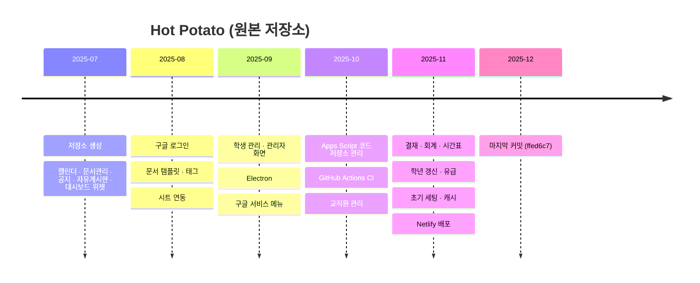

# Hot Potato ERP 구현 상태

> 개발 단계: **⑤ 구현 / ⑦ 수정 및 문서화** · 산출물: 구현 현황, 기술 백로그
> **구현 상태는 이 문서에서만 관리합니다.** 다른 문서에는 상태를 적지 않고 여기로 링크합니다.
> 이 저장소는 기준 커밋에서 멈춰 있습니다. 개발은 [hot_potato_remake](https://github.com/semicolon213/hot_potato_remake)에서 이어지며, 현재 상태는 [리메이크 STATUS](https://github.com/semicolon213/hot_potato_remake/blob/main/docs/STATUS.md)를 봐 주세요.

## 1. 기준 시점

| 항목 | 값 |
|---|---|
| 기준 커밋 | `main` @ `ffed6c7` (2025-12-01, "수정") |
| 문서 작성일 | 2026-10-27 |
| 마지막 검증 | [TEST_PLAN.md §4](./TEST_PLAN.md#4-자동-검사-결과-2026-10-27-main--ffed6c7) |

## 2. 기능별 상태

✅ 동작 · ⚠️ 동작하지만 알려진 결함 있음 · ⏳ 미구현·미연결

| 영역 | 기능 | 상태 | 비고 |
|---|---|---|---|
| 인증 | Google 로그인, 최근 계정 로그인 | ✅ | 30분 비활동 시 로그아웃 |
| 인증 | 가입 신청, 사전 등록, 승인 | ✅ | 승인 후 재로그인 필요 (BUG-08) |
| 인증 | 관리자 키로 관리자 가입 | ⚠️ | BUG-10 |
| 인증 | 가입 거부 | ⚠️ | BUG-02 |
| 인증 | 관리자 키 갱신 | ✅ | 매일 갱신 트리거는 수동 등록 필요 |
| 인증 | 관리자 키 메일 발송 | ⚠️ | BUG-12 |
| 인증 | 마이페이지 | ✅ | |
| 대시보드 | 위젯 추가·삭제·정렬, 개인 설정 파일 저장 | ✅ | |
| 공지 | 목록·상세·작성·수정·삭제, 공개 범위, 첨부·이미지 | ✅ | |
| 공지 | 고정 요청·승인, 조회수 | ✅ | |
| 문서 | 공유·개인 문서 목록, 업로드 | ✅ | |
| 문서 | 양식으로 생성 (나만 보기 / 권한 부여) | ✅ | |
| 문서 | 공유 양식·공용 태그·개인 태그·즐겨찾기 | ✅ | |
| 결재 | 요청 3유형, 검토·결재 승인, 보류·재개 | ✅ | 프론트 상태 표기 오타 (BUG-05) |
| 결재 | 검토 단계 반려 | ⚠️ | BUG-01 |
| 결재 | 결재 단계 반려, 재상신, 이력, 결재선 템플릿 | ✅ | |
| 회계 | 장부 생성, 입출금, 증빙, 잔액 계산 | ✅ | |
| 회계 | 카테고리 관리 | ✅ | 서버 조회 액션에 결함 있으나 화면은 사용 안 함 (BUG-07) |
| 회계 | 예산 계획 검토·승인·집행 | ⚠️ | BUG-04 |
| 회계 | 장부 내보내기 | ✅ | |
| 일정 | 역할별 캘린더 통합, 일정 CRUD, 반복 일정, 학사 일정 | ⚠️ | BUG-03 (집행부·겸임교원 캘린더) |
| 일정 | 개인 시간표 | ✅ | |
| 학생 | 목록·상세·추가·수정·삭제, 엑셀 일괄 등록, 학생회 | ✅ | |
| 학생 | 유급 표시 | ✅ | |
| 학생 | 연간 학년 자동 갱신 (1월 트리거) | ⚠️ | BUG-11. 화면에서 실행하는 기능 없음, 트리거 수동 등록 필요 |
| 교직원 | 교직원·위원회 관리 | ✅ | |
| 공통 | 캐시, 429 재시도, 수동 새로고침 | ⚠️ | BUG-06, BUG-13 |
| 공통 | Google 서비스 바로가기 (Apps Script, Sheets, Docs, Gemini, Groups) | ✅ | |
| 초기 세팅 | `initializeSystem()` (폴더·시트 생성) | ⚠️ | BUG-09 |
| 배포 | 웹 (Netlify) | ✅ | |
| 배포 | 데스크톱 (Electron) | ⚠️ | 패키징 앱의 로그인·API 경로 미검증 |
| CI | GitHub Actions | ⚠️ | 기준 커밋에서 test 잡 실패 ([TEST_PLAN.md §4](./TEST_PLAN.md#4-자동-검사-결과-2026-10-27-main--ffed6c7)) |
| 미사용 | 자유게시판(`src/pages/Board/`), 채팅(`Chat.tsx`), 회의록(`Proceedings.tsx`) | ⏳ | 메뉴에 연결 안 됨. 게시판 글 등록 로직 비어 있음 |
| 미구현 | 오프라인 안내, 오류 경계, 개인정보처리방침·이용약관, 취업 정보 입력 | ⏳ | 리메이크에서 추가 |

결함 상세는 [TEST_PLAN.md §6](./TEST_PLAN.md#6-결함-리포트-테스트코드-점검으로-발견)에 있습니다.

## 3. 프로젝트 이력

| 구분 | 기간 | 커밋 | 참여 |
|---|---|---|---|
| 원본 `semicolon213/hot_potato` | 2025-07-08 ~ 2025-12-01 | 666 | 6명 |

월별 커밋 수: 7월 43, 8월 35, 9월 190, 10월 218, 11월 179, 12월 1.
참여 인원은 커밋 작성자 이름·이메일 중 같은 사람으로 보이는 것을 합친 수입니다.

리메이크(`semicolon213/hot_potato_remake`, 2025-11-26 시작)는 이 저장소 코드에서 출발했습니다. 리메이크에서 바뀐 점은 [리메이크 STATUS §3](https://github.com/semicolon213/hot_potato_remake/blob/main/docs/STATUS.md#3-프로젝트-이력)에 있습니다.

## 4. 기술 백로그 (기준 시점)

우선순위: **P1** 다음 배포 전 · **P2** 이번 학기 · **P3** 여유 있을 때
"리메이크" 열은 2026-10-27 기준 리메이크 저장소에서 처리 여부입니다.

| 우선순위 | 항목 | 관련 | 리메이크 |
|---|---|---|---|
| P1 | 서버 측 인가 강화 (비공개 보안 과제) | [SECURITY.md](./SECURITY.md) | 일부 처리 |
| P1 | 검토 반려 오류 수정 | BUG-01 | 미해결 |
| P1 | 가입 거부를 현재 시트 구조로 수정 | BUG-02 | 미해결 |
| P1 | 관리자 가입 요청 필드 통일 | BUG-10 | 처리 |
| P1 | 예산계획 열 순서 통일 + 기존 장부 마이그레이션 | BUG-04 | 미해결 |
| P2 | 캘린더 역할 키 통일 | BUG-03 | 미해결 |
| P2 | 결재 상태 타입을 서버 값과 일치 | BUG-05 | 미해결 |
| P2 | `apiClient` 재시도: 시도마다 새 타임아웃, 쓰기 요청은 재시도 안 함 | BUG-06 | 미해결 |
| P2 | 카테고리 조회 시트 수정 | BUG-07 | 미해결 |
| P2 | 학년 갱신에서 유급 학생 제외 | BUG-11 | 처리 |
| P2 | 승인 대기 화면 자동 재확인 | BUG-08 | 미해결 |
| P2 | `initializeSystem` 실패 집계 | BUG-09 | 미해결 |
| P2 | 관리자 키 메일 발송 수정 | BUG-12 | 처리 |
| P2 | 백그라운드 갱신 페이지 키를 실제 페이지 이름과 일치 | BUG-13 | 미해결 |
| P2 | `type-check` 스크립트 수정, 테스트 스위트 복구, `prettier` 설치, CI test 잡 통과 | [TEST_PLAN.md §7](./TEST_PLAN.md#7-회귀-테스트-자동화-계획) | CI는 삭제하고 Netlify 빌드로 대체, 나머지 미해결 |
| P2 | 메인 번들 분할 (gzip 561kB) | [TEST_PLAN.md §4](./TEST_PLAN.md#4-자동-검사-결과-2026-10-27-main--ffed6c7) | 처리 (gzip 122kB, 번들 크기 검사 추가) |
| P2 | 오프라인 안내, 오류 경계 | | 처리 |
| P2 | 개인정보처리방침·이용약관 게시 | | 처리 |
| P3 | 폴더·시트 이름 환경변수 정리 (이름별 변수 다수) | | 처리 (JSON 환경변수 V2) |
| P3 | 조교가 화면에서 학년 갱신 실행, 졸업생 취업 정보 입력 | | 처리 |
| P3 | Apps Script 전역 함수 이름 중복 제거, 테스트 파일 정비 | [TEST_PLAN.md §5](./TEST_PLAN.md#5-apps-script-테스트-파일) | 미해결 |
| P3 | 미사용 화면(게시판·채팅·회의록) 정리 | | 게시판 삭제, 채팅·회의록 남아 있음 |
| P3 | Apps Script 동시 쓰기에 `LockService` 적용 | | 미해결 |
| P3 | Electron 패키징 앱의 OAuth·API 경로 지원 | | 미해결 |
| P3 | `package-lock.json`과 `bun.lock` 중 하나로 정리 | | 미해결 |
